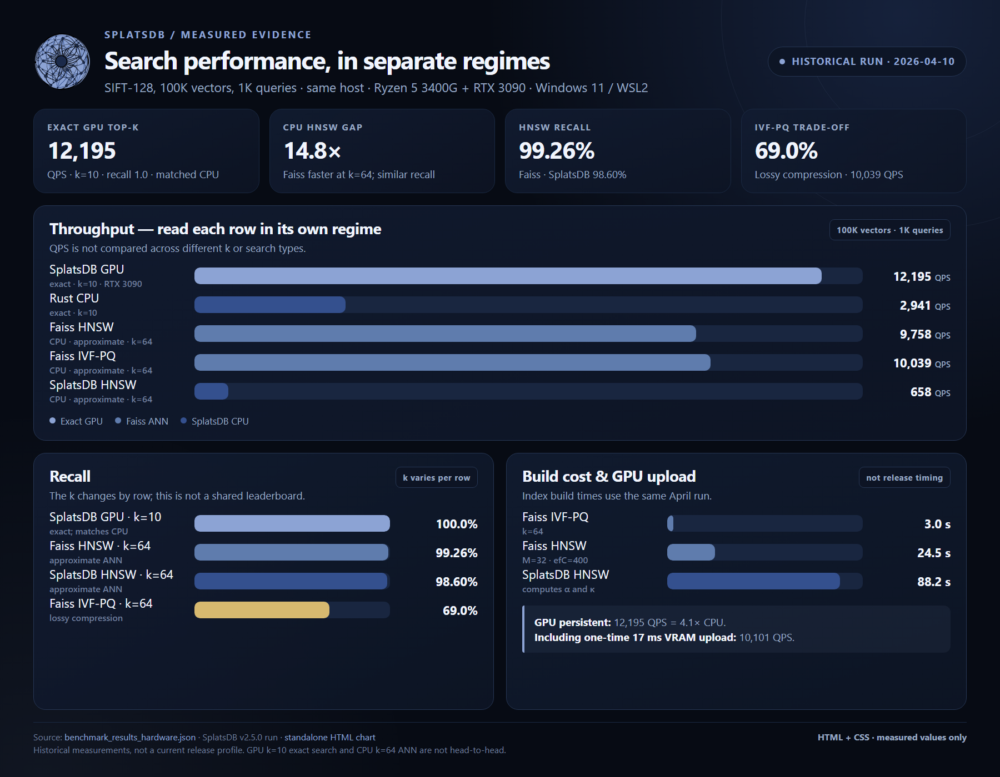
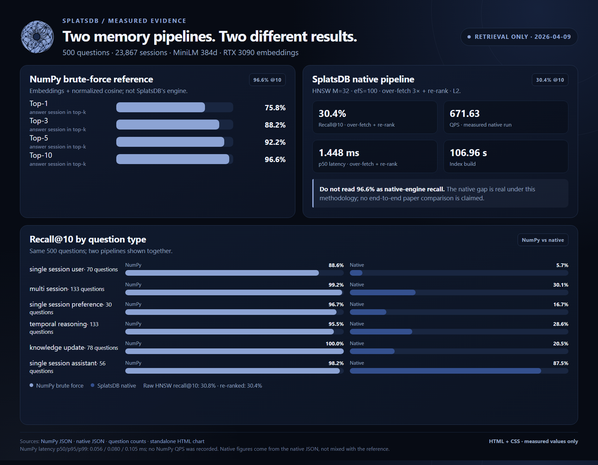
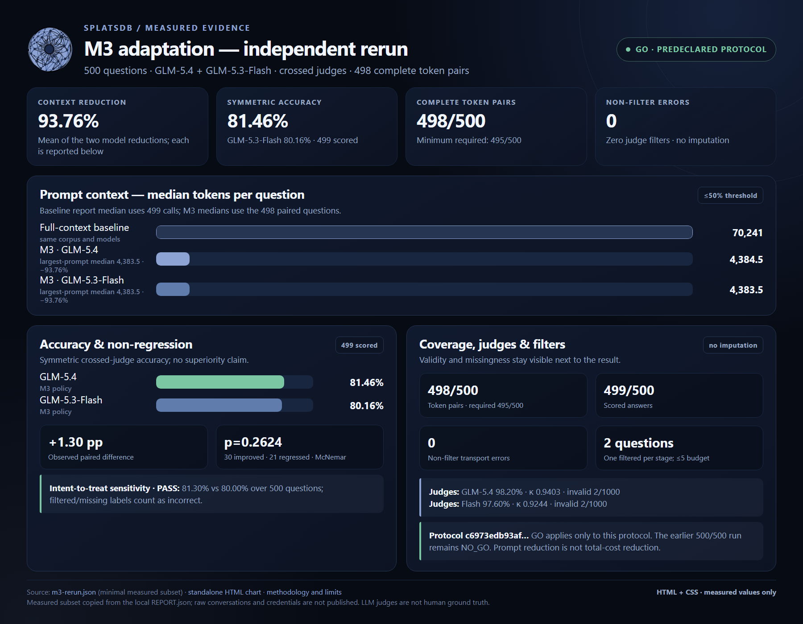

<p align="center">
  
</p>

<h1 align="center">SplatsDB</h1>

<p align="center">
Gaussian splat routing with exact raw-vector re-scoring. Knowledge graph + HNSW + GPU in one Rust binary.
</p>

[](https://github.com/schwabauerbriantomas-gif/SplatsDB/actions/workflows/ci.yml)
[](https://github.com/schwabauerbriantomas-gif/SplatsDB/releases)
[](LICENSE)
[](https://www.rust-lang.org/)
[](https://github.com/schwabauerbriantomas-gif/SplatsDB/actions/workflows/ci.yml)
[]()
[]()

---

<p align="center"><sub>Learned splat cells route queries to a small candidate pool; raw vectors are re-scored exactly. Distance-based flags are diagnostics, not correctness probabilities.</sub></p>

---

## Why SplatsDB?

SplatsDB is a **retrieval engine built around a field of Gaussian splats**, not a claim that Gaussian energy improves ranking by itself. The validated path uses learned splat centroids to route queries before exact re-scoring of raw vectors.

- **Measured routing utility:** against a random codebook at matched scan budgets, the learned `k=100` codebook improved recall@10 by **8.1 points at ~15% scan**. The frozen CI gate also passed at 20% and 40%, but those smaller effects (+3.6 and +0.7 points) are below the conservative 5-point small-sample noise floor and remain exploratory. [Protocol, aggregate results and limits](docs/validation/splat-routing.md).
- **Exact by construction when needed:** `field-search` uses cell radii and the triangle inequality. In the new gate it matched brute-force top-10 distances on 100/100 queries; it did **not** materially prune at 11k×384, so this is a correctness feature, not a measured speedup at that scale.
- **Ranking stays geometric:** candidate members are re-scored with exact L2. α/κ Gaussian energy is available for experiments, but the A5 audit found that mixing it into ranking degrades retrieval; it is not the basis of the validated benefit.
- **Integrated runtime:** MCP, knowledge graph, HNSW, optional GPU and memory profiles are exposed by the same binary. These are integration features, not evidence of a splat-specific quality gain.

For the external technical position, see the [primary-source SOTA review](docs/validation/sota-splats-routing.md): established IVF/quantization systems, anisotropic Gaussian partitioning, adaptive probing, probabilistic embeddings, decision calibration and current agent-memory evaluation. It also maps 3DGS methods—LOD hierarchies, anchors, error-driven density control, scale filtering and pruning/VQ—to falsifiable index experiments while excluding rendering metrics as retrieval evidence. A separate alternative-representation track covers Topo-GS, GraphSplatting and scientific-volume splatting for embedding, graph and spatial-data visualization, evaluated by topology/geometry/user-task metrics rather than ANN recall. The review makes the remaining opening explicit and unproven: angular low-rank cell routing, error-driven cell management or a closed-form splat-yield policy that beats matched IVF, ratio/doubling and learned controls.

### What is validated — and what is not

| Capability | Current evidence | Scope |
|---|---|---|
| Learned splat-cell routing | **Validated locally** | Low-scan effect clears the conservative noise floor; smaller effects remain exploratory |
| Exact triangle-bound field search | **Correctness validated** | No material pruning observed at 11k×384 |
| α/κ as a ranking improvement | **Falsified in A5** | Do not use energy as the default relevance score |
| `topic` / `confidence` | **Diagnostic only** | Distance-to-centroid membership; not calibrated correctness probability |
| Compression / smaller memory | **Not validated by the routing gate** | Raw member vectors are retained for exact re-scoring |
| Agent task success / hallucination prevention | **Not established** | MCP integration and verbatim sources do not prove better answers |
| GPU / HNSW / graph / M3 | **Separate components** | Not attributable to Gaussian splats without an isolating experiment |

### Comparison

The table records architecture and integration surface, not a claim that checkmarks imply superior retrieval quality.

| Feature | SplatsDB | Faiss | Pinecone | Qdrant | Milvus/Zilliz | LanceDB |
|---|---|---|---|---|---|---|
| Language | Rust | C++ | Go/Rust | Rust | Go+C++ | Rust |
| License | GPL-3.0 | MIT | Proprietary | Apache 2.0 | Apache 2.0 | Apache 2.0 |
| Splat-cell routing + exact re-scoring | ✅ | IVF family | — | — | IVF/graph family | — |
| Topic-membership diagnostic | ✅ (not calibrated) | — | — | — | — | — |
| Knowledge Graph | ✅ | — | — | — | — | — |
| Spatial Memory (Wing/Room/Hall/Tunnel) | ✅ | — | — | — | — | — |
| MCP server (18 tools) | ✅ | — | — | — | — | — |
| RRF result fusion | ✅ | — | — | — | ✅ | — |
| Self-hosted | ✅ | ✅ | ❌ SaaS-only | ✅ | ✅ | ✅ |
| Embedded (no server) | ✅ | ✅ | ❌ | ❌ | ❌ | ✅ |
| GPU custom kernels (15 total) | PTX | CUDA | Cloud | ❌ | ✅ Knowhere | ❌ |
| HNSW | ✅ | ✅ | ✅ | ✅ | ✅ | IVF-PQ |
| Vector compression | ✅ | ✅ | ✅ | ✅ | ✅ | ✅ |
| Pricing (cloud managed) | **Free** | N/A | $50–$500/mo | Usage-based | $99–$155/mo | Free |

> **Honest note:** Faiss remains the gold standard for raw CPU ANN throughput — its HNSW is **14.8× faster** than SplatsDB's HNSW on CPU (9,758 vs 658 QPS at k=64, recall 0.9926 vs 0.986). SplatsDB's GPU path is **brute-force exact top-k at k=10**: 12,195 QPS with the dataset persistent in VRAM. That is a different regime (exact vs approximate, k=10 vs k=64, GPU vs CPU) — not a like-for-like win over Faiss; see [Benchmarks](#benchmarks). The differentiating evidence is learned splat-cell routing plus the integrated runtime, not universal superiority.

---

## Table of Contents

- [Why SplatsDB?](#why-splatsdb)
- [What Is This?](#what-is-this)
- [Architecture](#architecture)
- [Quick Start](#quick-start)
- [How It Works](#how-it-works)
- [Benchmarks](#benchmarks)
- [Configuration Presets](#configuration-presets)
- [CLI Reference](#cli-reference)
- [MCP Server (AI Agent Integration)](#mcp-server-ai-agent-integration)
- [HTTP API Server](#http-api-server)
- [Rust API](#rust-api)
- [GPU Acceleration](#gpu-acceleration)
- [Knowledge Graph (GraphSplat)](#knowledge-graph-graphsplat)
- [Vector Compression (TurboQuant / PolarQuant)](#vector-compression-turboquant--polarquant)
- [Semantic Memory](#semantic-memory)
- [Hermes Memory Hub (Session Recall)](#hermes-memory-hub-session-recall)
- [Module Map](#module-map)
- [Dependencies](#dependencies)
- [Roadmap](#roadmap)
- [Spatial Memory Architecture](#spatial-memory-architecture)
- [Competitive Landscape](#competitive-landscape)
- [Security Audit](#security-audit)
- [Reproducible Benchmarks](#reproducible-benchmarks)
- [License](#license)

---

## What Is This?

SplatsDB stores a **field of Gaussian splats**. A splat carries a mean `μ`, persisted `α` and `κ`, and—in the validated routing path—a geometric cell radius `R` covering its raw member vectors.

The useful distinction is between **representation** and **ranking**:

- `μ` and the learned cell partition determine which candidates are gathered.
- Raw member vectors are re-scored with the embedding metric, preserving geometric ranking.
- `R` supports optional exact triangle-bound search.
- `α/κ` do not establish relevance or correctness probabilities; their use as an energy ranking signal was falsified in the A5 audit.

This makes the current utility concrete: **control how many vectors are examined before exact re-scoring, using a learned partition rather than an arbitrary one**. It does not require claiming probabilistic semantics that the measurements do not support.

**Key use cases:**

- Controlled-scan candidate retrieval over memory-resident embeddings
- Exact field search when correctness matters more than latency
- Self-hosted agent-memory infrastructure with MCP and verbatim source text
- Experimental Gaussian-energy scoring with an explicit negative-evidence warning

---

## Architecture

```
┌──────────────────────────────────────────────────────────────────┐
│                        Interfaces                                 │
│         CLI (clap)  │  MCP (stdio JSON-RPC)  │  HTTP API         │
├──────────────────────────────────────────────────────────────────┤
│                                                                   │
│  ┌──────────────┐  ┌─────────────────────────────────────────┐ │
│  │ Query Layer   │  │ GraphSplat                              │ │
│  │ Splat Routing │  │ Knowledge Graph                         │ │
│  │ + Exact      │  │ Hybrid Search +                         │ │
│  │ Re-scoring   │  │ BFS Traversal                           │ │
│  └──────┬───────┘  └──────────────────┬──────────────────────┘ │
│         └─────────────────────────────┼────────────────────────┘│
│                                       │                         │
│  ┌────────────────────────────────────▼────────────────────────┐│
│  │       Splat Cells (μ, α, κ, R) + Raw Member Vectors       │ │
│  │   μ: routing · R: exact bounds · α/κ: experimental        │ │
│  ├────────────────────────────────────────────────────────────┤ │
│  │  Compression: TurboQuant / PolarQuant (separate modes)     │ │
│  ├──────────────────────────────────────────────────────────────┤ │
│  │  Indexes: HNSW │ LSH │ KMeans++ (coarse → fine)             │ │
│  ├──────────────────────────────────────────────────────────────┤ │
│  │  Persistence: SQLite (WAL)  │  GPU: CUDA PTX (optional)     │ │
│  └─────────────────────────────┴───────────────────────────────┘ │
└──────────────────────────────────────────────────────────────────┘
```

---

## Quick Start

### Fast Start: full pipeline with embeddinggemma-2 (one command)

```bash
bash semantic-hub/faststart.sh
```

Brings up the local embedding server (`google/embeddinggemma-2`, 768-d, :8860), the SplatsDB hub with exact GPU search (:8871), and runs an end-to-end smoke. Then:

```bash
# 1) embed a query
EMB=$(curl -s -X POST http://127.0.0.1:8860/v1/embeddings \
  -H 'Content-Type: application/json' \
  -d '{"input": "tu consulta", "model": "embeddinggemma-2"}' \
  | python3 -c "import json,sys; print(json.dumps(json.load(sys.stdin)['data'][0]['embedding']))")

# 2) exact search on the GPU hub — results carry "topic" + "confidence"
curl -s -X POST http://127.0.0.1:8871/search \
  -H 'Content-Type: application/json' \
  -d "{\"query\": \"tu consulta\", \"embedding\": $EMB, \"top_k\": 10}"
```

### 30-Second Trial (No Rust Needed)

Download the [latest release binary](https://github.com/schwabauerbriantomas-gif/SplatsDB/releases) and run:

```bash
# Index pre-computed embeddings (any dimension, any provider)
# Format: [u64 n] [u64 dim] [f32 × n × dim]
splatsdb index --input embeddings.bin

# Search with a query vector
splatsdb search --query "0.12,0.45,-0.33,..." -k 10

# Or start MCP server for your AI agent
splatsdb mcp
```

### With Real Embeddings (OpenAI / Cohere / Local)

```bash
# Step 1: Generate embeddings with your provider
# OpenAI:
python3 -c "
import openai, struct, numpy as np
client = openai.OpenAI()
texts = ['Machine learning basics', 'Neural network architectures']
resp = client.embeddings.create(input=texts, model='text-embedding-3-small')
vecs = np.array([d.embedding for d in resp.data], dtype=np.float32)
n, dim = vecs.shape
with open('embeddings.bin','wb') as f:
    f.write(struct.pack('<QQ',n,dim)); f.write(vecs.tobytes())
print(f'Wrote {n} vectors, dim={dim}')
"

# Step 2: Index and search
splatsdb index --input embeddings.bin
splatsdb search --query "0.12,0.45,-0.33,..." -k 10

# Step 3 (optional): MCP server for agents
splatsdb mcp  # starts JSON-RPC on stdio
```

> **Note**: The MCP server can auto-embed text using a local embedding service (`all-MiniLM-L6-v2` via `SPLATSDB_EMBED_URL`). For production, always provide real embeddings — the built-in SimCos hash is for demos only.

### Build from Source

- **Rust** 1.56+ (Edition 2021)
- **C compiler** (for SQLite bundling via `rusqlite`)
- **CUDA Toolkit 12.x + MSVC `cl.exe`** (optional, for GPU acceleration)

### Build

```bash
# Default (v2.6.0): CUDA support included — compiles without nvcc,
# uses the GPU at runtime when a driver is present
cargo build --release

# CPU-only build (no CUDA code at all)
cargo build --release --no-default-features

# Run tests
cargo test   # full suite: 294 tests across 9 binaries (re-measured 2026-11-21): lib 211, main 2, chaos 8, integration 3, integration_gaussian 5, pentest_security 29, qa_validation 31, api_field_load 2, mcp_server_warmstart 3
```

### Run

```bash
# Check engine status
./target/release/splatsdb status --verbose

# Search with a query vector
./target/release/splatsdb search --query "0.1,0.2,0.3,...,-0.5" -k 10

# Start MCP server for AI agent integration
./target/release/splatsdb mcp

# Start HTTP API server
./target/release/splatsdb serve --host 0.0.0.0 --port 8199

# Ingest vectors from binary file
./target/release/splatsdb ingest --input vectors.bin --n-clusters 100
```

### Binary Format

SplatsDB uses a simple binary format for vector data:

```
[ u64: number of rows ] [ u64: number of columns ] [ f32 × rows × cols: data ]
```

---

## How It Works

## How It Works

### Splat cells and raw vectors

A splat mean `μ` is a learned position in embedding space. During `ingest`, KMeans learns the codebook and each raw vector is assigned to its nearest splat. The engine persists the raw vectors, splat means, memberships and cell radii.

- **μ (mean):** candidate-routing center.
- **R (radius):** maximum member-to-centroid distance; the geometric quantity used by exact bounds.
- **α (opacity) and κ (concentration):** available for experimental Gaussian scoring, but not required by two-phase routing and not calibrated confidence values.

The current routing evidence therefore supports **learned cell geometry**, not the statement that every document acquires a useful probabilistic interpretation merely by being assigned a splat.

### Two-Phase Splat Routing

1. Compute distances from the query to splat means.
2. Select the nearest `nprobe` cells.
3. Gather their raw member vectors through the persisted CSR layout.
4. Compute exact L2 scores for those candidates and return top-k.

Increasing `nprobe` exchanges more vector scans for higher candidate coverage. The measured learned-versus-random benefit is real at low scan budgets and becomes small when a large fraction of the corpus is already being examined. See the [predeclared routing gate](docs/validation/splat-routing.md) for primary and `k=200` sensitivity receipts.

### HRM2 Hierarchical Codebooks

HRM2 implements an alternative two-level coarse/fine KMeans retrieval path. The hierarchy is an index organization, not evidence of probabilistic uncertainty or automatically higher recall. The new routing gate uses flat `k=100` and `k=200` codebooks and does **not** validate HRM2; compare HRM2 separately at matched scan, recall, latency and memory before using it in a performance claim.

### Exact Triangle-Bound Field Search

Default `field-search` treats each splat as a cell with radius `R` and uses:

```text
d(q, x) ≥ d(q, μ) − R
```

A cell can be skipped only when its lower bound loses to a complete top-k threshold. This preserves exactness; it does not guarantee useful pruning on every corpus. At 11,069×384 the new gate visited 99.88% of clusters and scanned 99.9988% of vectors, so no material speed claim is made for that dataset.

### Gaussian Energy: Experimental, Not the Default Benefit

```text
score(i) = αᵢ · exp(−κᵢ · ‖q − μᵢ‖²)
```

This is a real implemented scoring mode, but A5 found that energy/density fusion degrades semantic retrieval instead of improving it. Uniform `α/κ` also reduces the Gaussian argmax to the minimum-distance argmax. Use geometric candidate ranking unless running a separately designed experiment; see [`A5_FINDINGS.md`](docs/A5_FINDINGS.md).

### Topic and Confidence Fields

The HTTP `topic` identifies the result's splat cell. Its numeric `confidence` is `1 − d/R`, clamped to `[0,1]`: a measure of how close a result lies to the cell center. MCP/verbatim HIGH/MEDIUM/LOW labels are fixed vector-distance bands. **Neither is a calibrated probability that a passage answers the question correctly.**

Verbatim retrieval is independently useful because the agent can inspect the original source, but that affordance does not prove hallucination prevention or better task outcomes.

### SimCos Embeddings

> ⚠️ **SimCos is for quick demos only.** For production, always use real embeddings (OpenAI, Cohere, MiniLM, etc). SimCos uses trigram hashing — it has no semantic understanding.

When no pre-computed embeddings are provided, SplatsDB uses **SimCos** — a similarity-consistent n-gram hashing scheme:

- Character trigrams are extracted from text
- Each trigram is hashed into the embedding dimension
- Overlapping n-grams between two texts produce high cosine similarity
- No model loading required — instant, deterministic, zero dependencies

SimCos is a **toy embedding** useful for quick demos and testing. For production use, pass pre-computed embeddings from your preferred model (OpenAI, Cohere, local transformers, etc.).

### No Uncertainty Inference from α/κ

`α` and `κ` affect experimental Gaussian energy, but they are not learned correctness or ambiguity estimates in this pipeline. No ranking/confidence example is provided: A5 falsified the tested energy-ranking benefit, and the current fields are not calibrated probabilities.

### Choosing a Search Path

- **HNSW:** default approximate graph retrieval for general vector search.
- **Two-phase splat routing:** use when explicit candidate-scan control and learned cell routing matter; measure recall against the exact route for the target corpus.
- **HRM2:** two-level coarse/fine retrieval; benchmark separately because the flat-codebook gate does not cover this path.
- **Exact field search:** use when exact geometric results are required; do not assume pruning will be fast at small scale or high dimension.
- **Gaussian energy:** experimental only; do not substitute it for geometric ranking based on the current evidence.

### Field Search: Splats as Cells with Radii

The v2.6 field search treats each splat as a cell with radius `R = max member→centroid distance`. The triangle inequality provides a safe lower bound; the pruning threshold becomes valid only after top-k is complete. Every ingest persists `field/` (members CSR + radii) plus a `raw` shard, so `field-search` (CLI) and `/field-search` (HTTP) work out of the box.

The exact route is valuable as a correctness reference and as an optional exact backend. Its measured pruning envelope is dataset-dependent, and the new 11k×384 receipt showed essentially full scan.

---

## Benchmarks

> **Integrity pledge**: every number in this section states its k, its recall, and its source (result file or command). Numbers that could not be traced to a source have been removed, not rounded or restated. Full reproducible tables with exact commands live in [BENCHMARKS.md](BENCHMARKS.md).

All numbers are measured on real hardware. Exact QPS figures are only comparable at the same k, same search type (exact vs approximate), and same hardware — each table below states those conditions.

### Methodology

- **Dataset**: SIFT-128 from [ANN-Benchmarks](https://github.com/erikbern/ann-benchmarks) (the industry standard for vector search benchmarking, created by Erik Bernhardsson / ex-Spotify)
- **Subset**: First 10K and 100K vectors from the 1M training set, first 1000 queries from the 10K test set
- **Ground truth**: Computed independently with `sklearn.neighbors.NearestNeighbors` (brute-force, `metric='euclidean'`, `algorithm='brute'`). Verified to match ANN-Benchmarks official GT on overlapping queries (100% agreement at top-10)
- **Hardware**: Windows 11 on Ryzen 5 3400G + RTX 3090 (24GB VRAM) + 16GB RAM. GPU benchmarks use CUDA PTX kernels compiled with nvcc 12.4 + MSVC
- **Tool**: Built-in `bench-hnsw` CLI command — loads vectors, builds HNSW, runs queries in-process (eliminates CLI spawn overhead)
- **HNSW config**: Advanced preset (M=32, ef_construction=400, ef_search=100)
- **Recall metric**: recall@10 — fraction of true top-10 nearest neighbors found by the algorithm
- **Metric note**: HNSW graph is built with cosine similarity, but `find_neighbors_fused()` re-ranks all candidates with exact L2 distance before returning. For SIFT-128 (normalized data), cosine and L2 top-10 overlap is 99.4%, so the metric mismatch does not meaningfully affect results
- **Validation**: Results re-run with a second independently generated GT. Numbers below are from the validated run

### HNSW Search (v2.5 — current)

HNSW graph with persistence (save/load to `hnsw_index.bin`), exact L2 distance re-ranking of candidates.

> **Measured 2026-07-05** with the built-in `bench-hnsw` CLI on synthetic SIFT-like data. Ground truth: brute-force L2 (NumPy). **Raw run output not preserved** — no result file backing this table exists on this branch (the validated JSON from commit `ab81716` lives on `main` and is not present here).

> **Provenance caveat**: the figures below come from April 2026 `bench-hnsw` runs whose raw output was not preserved as a result file on this branch. The maintainer's later validated re-run (commit `ab81716` on `main`, synthetic SIFT-like data, JSON `bench-data/hnsw_validated_results.json` — not present on this branch) measured lower numbers: 789 QPS / recall@10 0.861 at 10K, 242 QPS at 100K, on synthetic uniform-random data. Treat the table below as indicative until re-run with persisted results. **Note**: [BENCHMARKS.md §3](BENCHMARKS.md#3-splatsdb-hnsw-standalone-k10) shows the April figures as its headline (1,054 QPS / 0.998 at 10K) — neither table has a preserved raw artifact on this branch; they are different runs (April real-SIFT vs July synthetic) and not comparable with each other.

| Dataset | N | Dim | Build Time | p50 Latency | p95 | p99 | QPS | Recall@10 |
|---------|-------|-----|-----------|-------------|------|------|------|-----------|
| synthetic-sift128 | 10K | 128 | 22s* | 1.20ms | 1.69ms | 2.10ms | **789** | **0.861** |
| synthetic-sift128 | 100K | 128 | 982s* | 4.09ms | 5.12ms | 5.78ms | **242** | n/a† |

<details>
<summary><b>Why recall is lower than a typical SIFT-128 benchmark</b></summary>

This measurement uses **synthetic uniform-random data** (128-dim, uint8-valued, seed=42), not real ANN-Benchmarks SIFT. Synthetic data has no natural cluster structure, so it is harder for HNSW than real SIFT (which has learnable cluster patterns). These numbers validate the **code path and order of magnitude**. A run on real SIFT-128 data (which has natural clusters) would show higher recall. To reproduce (no result file is preserved; the `ab81716` JSON is not on this branch): `cargo run --release -- bench-hnsw --train bench-data/sift_train_10000.bin --queries bench-data/sift_queries_1000.bin --gt bench-data/sift_gt_10000.bin --dim 128 --k 10`.
</details>

*Build time is one-time — HNSW graph persists to `hnsw_index.bin`. Subsequent runs load from disk, skipping build entirely.
†Recall@10 for 100K not computed (brute-force GT on 100K×1000 was too expensive for this session). QPS and latency are valid.

> **Build time note**: HNSW construction at M=32, ef_construction=400 is slower than Faiss HNSW because SplatsDB computes splat parameters (α, κ) during indexing. The index persists to disk — build once, query forever. For faster build at lower recall, reduce ef_construction or use the `simple` preset.

### Comparison: HNSW vs Linear Scan vs HRM2 Splats

> **Raw run output not preserved for every row of this table**: the HNSW rows share the provenance caveat above (no result file on this branch), and the Linear scan and HRM2 rows likewise have no preserved artifact. Historical numbers, kept for context — do not cite as measured artifacts until re-run with persisted results.

| Method | Dataset | N | p50 Latency | QPS | Recall@10 |
|--------|---------|------|-------------|------|-----------|
| **HNSW (synthetic)** | synthetic-sift128 | 10K | **1.20ms** | **789** | **0.861** |
| **HNSW (synthetic)** | synthetic-sift128 | 100K | **4.09ms** | **242** | n/a |
| Linear scan | synthetic-sift128 | 10K | 1,143ms | 0.9 | 1.000 |
| HRM2 splats | SIFT-128 | 100K | 76ms | 11.0 | ~0.95* |

On synthetic data HNSW delivers **~875× speedup** over linear scan at 10K. Real-SIFT recall would be higher.

\* HRM2 row: **source not preserved** — no result artifact backs the ~0.95 recall or the 76ms/11.0 QPS pair (logged in [BENCHMARKS.md → Removed claims](BENCHMARKS.md#removed-claims)).

### Faiss Comparison (Same Hardware, Same Dataset)

> Same Ryzen 5 3400G + RTX 3090 host, same SIFT-128 100K dataset, 1,000 queries. Faiss from `faiss-cpu` 1.13.2. **Rows are not like-for-like**: the GPU row is brute-force exact search at k=10 (from `bench-gpu`), while the Faiss and CPU HNSW rows are approximate search at k=64 (from `bench_windows.py`). We report both k and recall per row; do not compare across regimes. Full data: `bench-data/benchmark_results_hardware.json` (2026-04-10).

| Index | Search type | k | Build | p50 | QPS | Recall@k |
|-------|-----------|---|-------|-----|------|----------|
| SplatsDB GPU (RTX 3090, VRAM-persistent) | brute-force exact | **10** | 17ms (VRAM upload) | 0.082ms | **12,195** | **1.0** (exact, verified vs CPU) |
| Faiss HNSW (M=32, efSearch=100, CPU) | approximate ANN | 64 | 24.5s | 0.10ms | 9,758 | 0.9926 |
| Faiss IVF-PQ (nprobe=32, CPU) | approximate ANN | 64 | 3.0s | 0.10ms | 10,039 | 0.69 |
| SplatsDB HNSW (CPU, ef=100) | approximate ANN | 64 | 88s | 1.52ms | 658 | 0.986 |

**Takeaways:**
- **Different regimes, not a head-to-head win**: SplatsDB GPU is exact brute-force top-k at k=10 on an RTX 3090 (12,195 QPS); Faiss HNSW CPU is approximate ANN at k=64 (9,758 QPS, recall 0.9926). The numbers are not directly comparable.
- GPU brute-force returns exact results — top-k verified identical to CPU reference (`results_match_cpu: true` in the JSON).
- GPU upload to VRAM: 17ms (one-time per dataset load); with upload included the GPU path is 10,101 QPS.
- On CPU like-for-like, **Faiss HNSW is 14.8× faster than SplatsDB HNSW** (9,758 vs 658 QPS at k=64) with similar recall (0.9926 vs 0.986). Faiss uses highly optimized C++ with BLAS/SIMD.
- SplatsDB HNSW build is ~3.6× slower (88s vs 24.5s) — it computes splat parameters (α, κ) during indexing.
- SplatsDB's current evidence is not raw ANN QPS superiority: it is learned splat-cell routing with exact re-scoring, plus separately integrated knowledge-graph, memory and spatial features
- Full results: `bench-data/benchmark_results_hardware.json`

> **Removed claims**: a previous version of this section claimed GPU throughput of 1,667 QPS at 640D and 20,000 QPS for linear scan over 100 splats. Both numbers had no preserved source (no result file or run log; the 640D figure was marked "untraced" in `ab81716`). They were removed rather than restated.

<p align="center"></p>

> Chart regenerated 2026-11-26 in HTML/CSS from [`bench-data/benchmark_results_hardware.json`](bench-data/benchmark_results_hardware.json) — [standalone source](assets/charts/faiss.html), [shared theme](assets/charts/theme.css), [artifact hashes](assets/charts/manifest.json). k and search type are stated per row; the historical v2.5.0 run is not a current release profile. The tables above and in [BENCHMARKS.md](BENCHMARKS.md) remain the source of truth.

### LongMemEval Agent Memory Benchmark

<p align="center"></p>

> Chart regenerated 2026-11-26 in HTML/CSS — [standalone source](assets/charts/longmemeval.html), [shared theme](assets/charts/theme.css). It shows the NumPy reference and native pipeline side by side, including per-question-type recall; the 96.6% figure is **not** native-engine recall.

> [LongMemEval](https://huggingface.co/datasets/xiaowu0162/longmemeval-cleaned) is the standard benchmark for evaluating long-term conversational memory in AI agents. Tests retrieval across 500 questions, each with ~48 sessions and ~490 turns.

**Pipeline**: Embed all ~24K sessions with `all-MiniLM-L6-v2` (384d, GPU RTX 3090) → cosine similarity search → measure if answer session appears in top-k.

> **Honest methodology note**: The recall numbers below were measured with **NumPy brute-force cosine similarity** (see [`longmemeval_full_results.json`](bench-data/longmemeval_full_results.json)), not SplatsDB's own HNSW. They validate the *retrieval approach* (embeddings + cosine), not SplatsDB's search engine specifically. A separate run using SplatsDB's native Rust HNSW ([`longmemeval_splatdb_native.json`](bench-data/longmemeval_splatdb_native.json)) showed recall@10 = 0.304 — see that file for details on why native HNSW recall is lower (session-grouping and ef_search tuning differ).

**Session Recall** (answer session found in top-k, NumPy brute-force):

| k | Recall |
|---|--------|
| 1 | 75.8% |
| 3 | 88.2% |
| 5 | 92.2% |
| 10 | **96.6%** |

**Per question type (Recall@10)**:

| Type | Questions | Recall@10 |
|------|-----------|-----------|
| knowledge-update | 78 | **100.0%** |
| multi-session | 133 | 99.2% |
| single-session-assistant | 56 | 98.2% |
| single-session-preference | 30 | 96.7% |
| temporal-reasoning | 133 | 95.5% |
| single-session-user | 70 | 88.6% |

**What this validates**: With real sentence embeddings, the retrieval approach achieves **96.6% recall@10** on conversational memory retrieval. The system excels at knowledge-update (100%) and multi-session queries (99.2%). Temporal-reasoning (95.5%) and preference questions (96.7%) — where the original keyword baseline showed 30% and 0% — are dramatically improved by semantic search.

> **Comparison caveat**: the paper's best of 86.2% measures **end-to-end systems** (retrieval + reading + answer extraction); SplatsDB's 96.6% measures **retrieval only** (answer session in top-k). The two numbers are not like-for-like — retrieval-only is an easier task. We report both and do not claim a system-level win.

- Full results: `bench-data/longmemeval_full_results.json`
- Benchmark script: `bench-data/longmemeval_full.py`
- Previous keyword baseline: `bench-data/longmemeval_baseline_results.json`

#### Adapted M3 context-reduction evaluation — independent rerun

<p align="center"></p>

> Chart regenerated 2026-11-26 in HTML/CSS — [standalone source](assets/charts/m3-rerun.html), [measured subset](assets/charts/data/m3-rerun.json), [shared theme](assets/charts/theme.css). The chart keeps the earlier NO_GO run explicitly scoped and separate.

A separate local adaptation of `m3-glm-protocol` @ `15795ca` was evaluated with GLM-5.4 and GLM-5.3-Flash using crossed judges and a new full-context baseline. A **[predeclared independent rerun](docs/validation/m3-adaptation-rerun-protocol.md)** (protocol SHA `c6973edb93af`) returned **GO**: median prompt usage fell **93.76%** (70,241 to 4,384.5/4,383.5 tokens), with 498/500 complete token pairs; symmetric accuracy was **81.46% vs 80.16%** (+1.30 pp, McNemar p=0.2624), and the intent-to-treat sensitivity also passed. One question per stage was filtered in both models, within the predeclared budget; there were zero non-filter errors and no imputation. See [methodology, results and limitations](docs/validation/m3-adaptation-rerun.md). The [earlier run](docs/validation/m3-adaptation.md) remains **NO_GO** under its stricter 500/500 rule; this rerun does not reinterpret it.

### GPU Top-K Search (Custom CUDA Kernels)

Combined distance + top-k selection in one GPU pass. Dataset persists in VRAM between queries. Benchmarked on RTX 3090 (24GB VRAM), SIFT-128, 100K vectors, 1,000 queries, **k=10, exact brute-force** (recall 1.0 — top-k verified identical to CPU reference). Source: `bench-data/benchmark_results_hardware.json` (2026-04-10).

| Dataset | Dim | Queries | k | CPU QPS | GPU Persistent QPS | GPU + Upload QPS | Speedup (persistent) |
|---------|-----|---------|---|---------|--------------------|------------------|----------------------|
| 100K | 128 | 1,000 | 10 | 2,941 | **12,195** | 10,101 | **4.1×** |

- Upload bandwidth: **~3 GB/s** (PCIe); one-time VRAM upload of 17ms
- Per-query latency with dataset in VRAM: **0.082 ms**
- CPU baseline here is the same brute-force top-k in Rust (rayon), not HNSW — the 4.1× is GPU-vs-CPU of the same exact algorithm
- Custom PTX `l2_topk_kernel` compiled with nvcc 12.4 + MSVC

#### GPU vs CPU kernel microbenchmark (640D)

Two runs of `cargo test --release --features cuda test_ptx_kernel_performance` (`src/gpu/mod.rs`) on this repository, WSL2 + RTX 3090 — same shape (synthetic data, fixed seed 12345, 10,000 vectors × 640D, 100-query batch), different kernel paths, **not directly comparable**; both rows stay, labeled:

| Run | Kernel path | CPU (single-thread) | GPU (RTX 3090) | Speedup | Source |
|-----|-------------|--------------------|----------------|---------|--------|
| 2026-10-15 (single run) | `batch_l2_distances` — full distance matrix, **no top-k** | 565 ms | 27 ms | 20.93× | transcribed from the test log; no persisted artifact |
| **2026-10-25 (median of 6)** | `l2_topk` — fused top-k, **k=16** | 630 ms | 20 ms | **30.6×** | transcribed from the test log; no persisted artifact |

2026-10-25 per-run spread: 31.28×, 34.32×, 29.0×, 25.45× (GPU outlier during concurrent cargo builds), 30.0×, 33.82× — range GPU 17–29 ms, CPU 563–738 ms. Both runs are kernel-level microbenchmarks on synthetic data, not end-to-end search benchmarks; at this shape GPU time is dominated by the one-time dataset upload (~25 MB amortized over 100 queries per call) — the production win of the VRAM dataset cache (v2.7.0) is at the call-graph level: upload once per dataset version instead of every call. Companion correctness test `test_ptx_kernel_correctness` passes (GPU/CPU agreement within tolerance). Full per-run table and reproduction commands: [BENCHMARKS.md §4](BENCHMARKS.md#4-gpu-vs-cpu-kernel-microbenchmark-640d).


### CUDA Kernel Optimizations

**Distance kernels** (`kernels/distance.cu` — 7 kernels: `l2_distance`, `batch_l2_distance`, `cosine_distance`, `batch_cosine_distance`, `l2_topk`, `cosine_topk`, `gaussian_topk`):
- `float4` vectorized loads (640D = 160 × float4 per vector)
- Shared memory query cache (avoids redundant global reads per thread)
- Thread-local sorted top-k (max K=32) with shared memory merge
- `__launch_bounds__(256)` for optimal sm_86 occupancy
- PTX compiled with `--use_fast_math -O3`

**Extended kernels** (`kernels/extended_kernels.cu` — 8 kernels, added v2.5):
- `rotation_gemv_kernel` / `rotation_gemv_inverse_kernel` — batch R·x and R^T·x with float4 loads + shared mem query cache
- `qjl_batch_sketch_kernel` — batch sign(G·x) for QJL quantization (N vectors × G projections)
- `qjl_batch_ip_estimate_kernel` — batch inner product estimation from sketches with precomputed proj·query
- `kmeans_assign_kernel` — N×K×D assignment in single kernel (KMeans++ hot path)
- `cosine_similarity_kernel` — all-pairs cosine sim with tile-based 16×16 upper triangle computation
- `batch_geodesic_kernel` — pairwise arccos distance between matched vector pairs
- `lsh_batch_hash_kernel` — batch LSH hash sign bits across T tables × K projections

All extended kernels use float4 vectorized loads, shared memory caching, and `__launch_bounds__(256)`. Each has a CPU fallback via `Option`-returning functions — no CUDA dependency required at runtime.

**Rust GPU layer** (`src/gpu/cuda_extended.rs`):
- `GpuExtended` — stateless kernel launcher (no persistent GPU state)
- Public API in `gpu/mod.rs`: `rotation_gemv()`, `rotation_gemv_inverse()`, `qjl_batch_sketch()`, `qjl_batch_ip_estimate()`, `kmeans_assign()`, `cosine_similarity_matrix()`, `batch_geodesic()`, `lsh_batch_hash()`
- Auto-fallback: if CUDA unavailable, returns `None` and caller uses CPU path

### Published Benchmarks (BEIR / LOCOMO / MemoBench-style)

The following benchmarks are implemented in [`benchmarks/benchmark_reproducible.py`](benchmarks/benchmark_reproducible.py) and executed with persisted results in `bench-data/` (full tables below and in [Reproducible Benchmarks](#reproducible-benchmarks)). MemoBench-style is synthetic (seed=42, deterministic) pending release of the official dataset.

| Benchmark | Domain | What It Tests | Status |
|-----------|--------|---------------|--------|
| **BEIR** | 5 IR domains (scifact, trec-covid, fiqa, arguana, nfcorpus) | Standard information retrieval: NDCG@10, Recall@10, MAP across diverse text corpora | ✅ 0.461 NDCG@10 |
| **LOCOMO** | Long-form conversational memory | Cross-session recall in multi-turn dialogs with temporal/counterfactual/causal reasoning | ✅ 68.2% Recall@10 |
| **MemoBench-style** | Multi-agent dialog memory | Cross-session recall of agent preferences and facts (synthetic data — labeled accordingly) | ✅ 100% Recall@10 |

**BEIR** uses the standard evaluation protocol from [beir.ai](https://github.com/beir-cellar/beir) — no per-dataset tuning, no cherry-picking domains. The implementation downloads datasets, encodes with `all-MiniLM-L6-v2`, builds Faiss index, and computes NDCG@10, Recall@10, MAP using pytrec-eval.

**BEIR Results** (5 domains, model: all-MiniLM-L6-v2):

**Source:** `bench-data/beir_results.json`

| Domain | Corpus | Queries | NDCG@10 | Recall@10 | MAP@10 | QPS |
|--------|--------|---------|---------|-----------|--------|------|
| scifact | 5,183 | 300 | **0.645** | **0.783** | **0.596** | 6,990 |
| arguana | 8,674 | 1,406 | 0.502 | **0.790** | 0.412 | 6,416 |
| trec-covid | 171,332 | 50 | 0.473 | 0.013 | 0.011 | 283 |
| fiqa | 57,638 | 648 | 0.369 | 0.441 | 0.291 | 1,031 |
| nfcorpus | 3,633 | 323 | 0.316 | 0.155 | 0.111 | 13,683 |
| **Average** | | | **0.461** | **0.437** | **0.284** | 5,681 |

**LOCOMO** ([KimmoZZZ/locomo on HuggingFace](https://huggingface.co/datasets/KimmoZZZ/locomo)) evaluates long-form conversational memory across 19 sessions per conversation, with QA pairs spanning factoid, temporal, counterfactual, and causal categories.

**MemoBench-style** is a synthetic benchmark (seed=42, deterministic) since the official MemoBench dataset is not yet publicly available. It tests the same capabilities — cross-session agent memory recall — with clearly labeled synthetic data. We will replace it with the official dataset when available.

**LOCOMO Results** (1,982 questions across 10 conversations):

| Category | Questions | Recall@10 |
|----------|-----------|-----------|
| cat_5 (session matching) | 446 | **100.0%** |
| causal | 841 | **73.7%** |
| factoid | 282 | 52.8% |
| counterfactual | 92 | 38.0% |
| temporal | 321 | 31.8% |
| **Overall** | **1,982** | **68.2%** |

**Source**: `bench-data/locomo_results.json` (v1 pipeline, run 2026-04-11).

**MemoBench-style Results** (15 questions, 5 agents, 20 sessions):

| k | Recall@k |
|---|----------|
| 1 | 93.3% |
| 5 | 100.0% |
| 10 | **100.0%** |

**Source**: `bench-data/memobench_results.json` (synthetic, seed=42, run 2026-04-11).

Run any benchmark:
```bash
python benchmarks/benchmark_reproducible.py --suite beir       # BEIR (5 domains)
python benchmarks/benchmark_reproducible.py --suite locomo     # LOCOMO
python benchmarks/benchmark_reproducible.py --suite memobench  # MemoBench-style
python benchmarks/benchmark_reproducible.py --suite all        # Everything
```

**Integration points** (GPU-accelerated hot paths):
- `clustering.rs` — KMeans assignment step: GPU → rayon CPU fallback
- `geometry.rs` — cosine_similarity_matrix + geodesic_distance_batch: GPU → ndarray CPU
- `quant/rotation.rs` — batch rotation GEMV: GPU → sequential CPU

### HRM2 vs Linear Scan (Python Prototype — Historical)

An earlier Python prototype claimed a **32× speedup** for HRM2 vs linear scan on 100K vectors (100K splats, 1K queries, k=64, CPU). Referenced for historical context only.

> **NOT VALIDATED — no source artifact**: a table previously shown here, labeled "Validated Rust result" (Linear scan 94.79 ms / 10.55 QPS vs SplatsDB HRM2 0.99 ms / 1,012.77 QPS = **32.4×**), has been removed: no result JSON or run log backs it, and its arithmetic is internally inconsistent (1,012.77 / 10.55 ≈ 96×, not 32.4×). The removal is recorded in [BENCHMARKS.md → Removed claims](BENCHMARKS.md#removed-claims). If re-measured with a persisted result file, real numbers may return.

---

## Configuration Presets

The presets cover edge devices to GPU workstations, including the `hermes` runtime profile for local memory hubs. Each preset configures all subsystems at once — no manual flag toggling required. (The `training` preset and its subsystems — data lake, distillation, leader clustering — were removed in v2.6.1 as unvalidated dead weight.)

| Preset | Use Case | Capacity | Quantization | Graph | Semantic | GPU | HNSW | LSH |
|--------|----------|----------|-------------|-------|----------|-----|------|-----|
| `default` | General purpose | 100K | 8-bit TurboQuant | ✅ | ✅ RRF | — | — | — |
| `hermes` | Local Hermes memory hub | 100K | — | — | — | Auto (`--gpu`) | ✅ | — |
| `simple` | Edge / IoT | 10K | — | — | — | — | — | — |
| `mcp` | AI agent memory | 100K | 8-bit TurboQuant | ✅ | ✅ RRF | Auto | — | — |
| `advanced` | AI agents | 1M | 4-bit TurboQuant | ✅ | ✅ RRF | Optional | ✅ M=32 | — |
| `gpu` | CUDA servers | 5M | 4-bit TurboQuant | ✅ | ✅ | ✅ | ✅ M=48 | — |

```rust
use splatsdb::config::SplatsDBConfig;

let edge    = SplatsDBConfig::simple(None);              // Raspberry Pi
let agent   = SplatsDBConfig::mcp(None);                 // AI agent memory (auto GPU)
let hermes  = SplatsDBConfig::hermes(None);              // Local memory hub
let heavy   = SplatsDBConfig::advanced(Some("cuda"));    // Full-featured with GPU
let server  = SplatsDBConfig::gpu(None);                 // Maximum GPU performance
```

**Device auto-detection**: Pass `None` to auto-detect (CUDA → Vulkan → CPU). Pass `Some("cuda")`, `Some("vulkan")`, or `Some("cpu")` to force a specific device.

### Choosing a Preset

```
Start
  ├─ <10K docs, no GPU? → simple
  ├─ AI agent, need memory? → mcp (auto GPU)
  ├─ Hermes memory hub? → hermes (HNSW + exact GPU with --gpu)
  ├─ >100K docs, need speed? → advanced (HNSW M=32)
  ├─ >5M docs + CUDA? → gpu (M=48, VRAM-persistent)
```

### Hermes runtime profile

For a local Hermes memory hub, use the named profile rather than disabling subsystems ad hoc:

```bash
splatsdb --dim 768 serve --profile hermes --gpu \
  --host 127.0.0.1 --port 8872 --data-dir /path/to/hub
```

The profile keeps the hub's HNSW candidate path and exact GPU L2 re-rank, uses the e-means trainer, and disables unused quantization, graph, LSH, map-reduce, auto-scaling, quality-reflection, training, data-lake and entity-extraction paths. `--profile` accepts `default` or `hermes`; an unknown name exits with code 2. `--max-splats` and the other server flags remain explicit overrides.

**Local profile validation** (RTX 3090, 768D, top-30, three rounds per arm): **9/9 ranking parity**, median startup **0.950 s vs 2.415 s**, p50 **3.774 vs 3.949 ms**, p95 **4.259 vs 4.321 ms**, and RSS **136,064 vs 139,164 KiB** for Hermes vs default at the same 32,768-splat capacity. This is a no-regression result for the tested configuration, not a universal performance claim. See [the A/B report](docs/validation/hermes-profile-ab.md) for methodology and limits.

---

## CLI Reference

SplatsDB provides a comprehensive CLI for all operations. Global options apply to every command.

### Global Options

| Flag | Default | Description |
|------|---------|-------------|
| `--data-dir <DIR>` | `./splatsdb_data` | Storage directory |
| `--dim <DIM>` | `64` | Vector dimensionality |
| `--max-splats <N>` | `100000` | Maximum splat capacity |
| `--backend <BACKEND>` | `sqlite` | Metadata storage backend (`sqlite` or `json`) |
| `--trainer <KIND>` | `lloyd` | HRM2 clustering trainer (`lloyd` or `emeans` — faiss contrib port, −32% t_fit) |

### Core Commands

| Command | Description |
|---------|-------------|
| `status` | Show store statistics (active splats, entropy, index status) |
| `search --query "0.1,0.2,..." -k 10` | Search by comma-separated query vector |
| `search-file --input query.bin -k 10` | Search using query vector from binary file |
| `index --input data.bin --shard default` | Add vectors from binary file |
| `append --input data.bin` | Incrementally add vectors to existing HNSW graph (no full rebuild) |
| `save` | Save current state to disk |
| `load` | Load state from disk |
| `list` | List all stored shards |
| `backup --output ./backup/` | Backup all data to directory |

### Ingestion Commands

| Command | Description |
|---------|-------------|
| `ingest --input data.bin --n-clusters 100` | KMeans splat centroids via DatasetTransformer (also persists `raw` shard + `field/`) |
| `ingest-hierarchical --input data.bin --n-clusters 10` | Two-level hierarchical KMeans |
| `field-search --query "0.1,..." -k 10` | Search over the splat field — exact triangle-bounds mode by default; `--nprobe N` switches to two-phase IVF (approximate), `--gpu` runs phase 1 on the PTX kernel |

### Search Backend Commands

| Command | Description |
|---------|-------------|
| `fused-search --query "0.1,..." -k 10` | Search all enabled backends with score fusion |
| `hnsw-search --query "0.1,..." -k 10` | HNSW index only |
| `lsh-search --query "0.1,..." -k 10` | LSH index only |

### Quantization Commands

| Command | Description |
|---------|-------------|
| `quant-index --algorithm turbo --bits 4` | Build compressed index (TurboQuant or PolarQuant) |
| `quant-search --query "0.1,..." --top-k 10` | Search compressed codes |
| `quant-status` | Show quantization statistics |

### GPU Commands (CUDA enabled by default since v2.6.0; `--no-default-features` builds CPU-only)

| Command | Description |
|---------|-------------|
| `gpu-info` | Show CUDA device information and VRAM status |
| `bench-gpu --n-vectors 100000 --dim 640` | Benchmark GPU vs CPU search |
| `bench-gpu-ingest --n-vectors 100000 --dim 640` | Benchmark full GPU ingest + search pipeline |

### Energy / Self-Organized Criticality

| Command | Description |
|---------|-------------|

### Document Commands

| Command | Description |
|---------|-------------|
| `doc-add --id my-doc --text "content"` | Add document with metadata |
| `doc-get --id my-doc` | Retrieve document by ID |
| `doc-del --id my-doc` | Soft-delete a document |

### Knowledge Graph Commands

| Command | Description |
|---------|-------------|
| `graph-add-doc --text "content"` | Add document node to graph |
| `graph-add-entity --name "entity" --entity-type person` | Add entity node |
| `graph-add-relation --source-id 1 --target-id 2 --relation-type MENTIONS` | Add edge |
| `graph-traverse --text \"query\" --max-depth 3` | BFS traversal from embedding-matched node |
| `graph-search --query "search text" --k 10` | Hybrid graph+vector search |
| `graph-stats` | Graph statistics |

### Server Commands

| Command | Description |
|---------|-------------|
| `serve --host 0.0.0.0 --port 8199 [--profile default\|hermes]` | Start HTTP API server (`--gpu` enables exact GPU search; `hermes` optimizes the local memory-hub runtime) |
| `mcp` | Start MCP server (stdio JSON-RPC 2.0) |
| `preset-info [--preset default\|simple\|mcp\|advanced\|gpu\|hermes]` | Show which subsystems each preset enables |

### ML & Entity Commands

| Command | Description |
|---------|-------------|

### Benchmark Commands

| Command | Description |
|---------|-------------|
| `bench-hnsw --train data.bin --queries q.bin --gt ground.bin --dim 128` | HNSW benchmark with recall measurement |

### Verbatim & Compression Commands

Verbatim text storage, AAAK text compression, and the remaining benchmark commands (all defined in the `Commands` enum, `src/cli/mod.rs`).

| Command | Description |
|---------|-------------|
| `verbatim-store --id my-doc --text "verbatim content" [--category notes]` | Store document with verbatim text (Drawer layer, alpha) |
| `verbatim-get --id my-doc` | Retrieve the original document text by ID |
| `verbatim-search --query "search text" -k 10` | Search with HIGH/MEDIUM/LOW confidence on verbatim text |
| `compress --text "long text" [--verbose]` | AAAK text compression (semantic + binary) with stats |
| `compress-bench --size small\|medium\|large` | Measure AAAK compression ratio on sample text |
| `decompress --data <hex>` | Decompress AAAK binary data (hex-encoded) back to semantic text |
| `bench-gaussian -n 100000 -q 100 -k 10 [-s 42] [--hnsw-m 16] [--hnsw-ef-construction 200] [--hnsw-ef-search 50] [--candidate-mult 10] [--out results.json] [--gt-out gt.bin]` | A/B benchmark: κ-weighted Gaussian ranking vs pure L2 (synthetic splats) |
| `bench-longmemeval --sessions sessions.bin --queries queries.bin --meta meta.json [-k 10] [--ef-search 100] [--over-fetch 3]` | LongMemEval with the native pipeline (spatial filter + vector search) |

### Spatial Memory Commands

| Command | Description |
|---------|-------------|
| `spatial-search --query "text" --wing project-x --room auth --hall decisions` | Search with spatial filters (Wing/Room/Hall) |
| `spatial-info` | Show spatial memory structure (wings, rooms, tunnels) |

---

## MCP Server (AI Agent Integration)

SplatsDB includes a built-in **Model Context Protocol** server for direct integration with AI agents. The MCP server uses stdio transport with JSON-RPC 2.0 and auto-loads the `mcp` preset with GPU auto-detection.

### Environment Variables

| Variable | Default | Description |
|----------|---------|-------------|
| `SPLATSDB_DOC_PATH` | `~/.hermes/splatsdb_docs.db` | SQLite database path for document persistence |
| `SPLATSDB_EMBED_URL` | `http://127.0.0.1:8788/embed` | Embedding service URL (MiniLM or compatible) |

### Security & Stability Features

- **No panics**: All `.unwrap()` / `.expect()` calls replaced with safe error handling
- **Input validation**: Text length capped at 100KB, entity names at 10KB, `k` capped at 1000
- **No info leakage**: Mutex poisoning logged to stderr only, generic error returned to client
- **Incremental indexing**: Uses `hnsw_sync_incremental()` instead of full rebuild on every insert
- **LRU text cache**: In-memory document text cache with 10K entry cap and automatic eviction
- **Warm start**: Progress logging every 100 docs, capped at 50K docs, interruptible by SIGINT
- **Graceful shutdown**: SIGINT triggers clean exit (completes current request, persists state)
- **JSON-RPC validation**: Rejects requests with `jsonrpc != "2.0"` with proper error code

### Configuration

Add to your AI agent's MCP configuration (e.g., Claude Code, Cursor, Hermes):

```json
{
  "mcp_servers": {
    "splatsdb": {
      "command": "/path/to/splatsdb",
      "args": ["mcp"],
      "timeout": 30
    }
  }
}
```

### Available Tools

#### Vector Store

| Tool | Required Params | Optional Params | Description |
|------|----------------|-----------------|-------------|
| `splatsdb_store` | `text` | `id`, `category`, `embedding`, `wing`, `room`, `hall` | Store a memory. Auto-embeds text via SimCos, or accepts pre-computed embedding. Spatial params (`wing`/`room`/`hall`) enable pre-filter search via `splatsdb_spatial_search`. **For production, always provide real embeddings via the `embedding` field.** |
| `splatsdb_search` | `query` | `top_k`, `embedding` | Semantic search. Returns ranked results with similarity scores. |
| `splatsdb_status` | — | — | Engine status: dimension, doc count, active indexes, quantization state. |

#### Document Store (SQLite-Backed)

| Tool | Required Params | Optional Params | Description |
|------|----------------|-----------------|-------------|
| `splatsdb_doc_add` | `id`, `text` | `metadata` (JSON) | Store document with metadata. Persists to SQLite. Survives restarts. |
| `splatsdb_doc_get` | `id` | — | Retrieve document by ID. Returns text, metadata, timestamps. |
| `splatsdb_doc_del` | `id` | — | Soft-delete a document. |

#### Knowledge Graph (GraphSplat)

| Tool | Required Params | Optional Params | Description |
|------|----------------|-----------------|-------------|
| `splatsdb_graph_add_doc` | `text` | — | Add document node. Auto-embeds text via SimCos (**use real embeddings in production**). |
| `splatsdb_graph_add_entity` | `name`, `entity_type` | — | Add entity node (person, org, location, concept). Auto-embeds name via SimCos (**use real embeddings in production**). |
| `splatsdb_graph_add_relation` | `source_id`, `target_id`, `relation_type` | `weight` | Add directed edge between nodes. |
| `splatsdb_graph_traverse` | `text` | `max_depth`, `add_doc` | BFS traversal. Auto-embeds query, finds nearest node, traverses graph. Use `--add-doc` to add the text as a document first. |
| `splatsdb_graph_search` | `query` | `k` | Hybrid search: vector similarity + graph context boost. |
| `splatsdb_graph_search_entities` | `query` | `k` | Search entity nodes by embedding similarity. |
| `splatsdb_graph_stats` | — | — | Node counts, edge counts, entity/document breakdown. |
| `splatsdb_spatial_search` | `query` | `wing`, `room`, `hall`, `top_k` | Search with spatial filters. Pre-filters by wing/room/hall metadata before vector search for higher recall. |
| `splatsdb_spatial_info` | — | — | Show spatial memory structure: wings, rooms, halls, tunnels (auto-detected cross-wing connections). |

#### Verbatim & Compression (alpha)

| Tool | Required Params | Optional Params | Description |
|------|----------------|-----------------|-------------|
| `splatsdb_verbatim_search` | `query` | `top_k` (default 10) | Search with heuristic vector-distance bands and original verbatim text for verification. HIGH/MEDIUM/LOW are diagnostics, not calibrated correctness probabilities. |
| `splatsdb_compress` | `text` | — | Compress text with AAAK (semantic + binary compression). Returns semantically compressed text that LLMs can read natively, plus binary compressed data for storage. |
| `splatsdb_decompress` | `data` | — | Decompress AAAK binary data (hex-encoded) back to LLM-readable semantic text. |

### Example: AI Agent Session

```
Agent: splatsdb_store(text="User prefers dark mode and Spanish language")
→ {"id": "mem_1", "status": "stored"}

Agent: splatsdb_graph_add_entity(name="Brian", entity_type="person")
→ {"entity_type": "person", "name": "Brian", "node_id": 1}

Agent: splatsdb_graph_add_doc(text="Brian works on SplatsDB, a vector search engine")
→ {"node_id": 2, "node_type": "document"}

Agent: splatsdb_graph_add_relation(source_id=2, target_id=1, relation_type="MENTIONS")
→ {"ok": true, "relation_type": "MENTIONS"}

Agent: splatsdb_search(query="user preferences", top_k=5)
→ {"results": [{"id": "mem_1", "score": 0.95, "text": "User prefers dark mode..."}]}

Agent: splatsdb_graph_search(query="who works on vector search", k=3)
→ {"results": [{"content": "Brian works on SplatsDB...", "score": 0.49}]}
```

### Persistence

The MCP server uses SQLite with WAL mode for document storage. On restart, all documents are automatically reloaded (warm start) with progress logging. HNSW indices use **incremental insertion** — new vectors are added to the existing graph without rebuilding. Vector indices persist to `hnsw_index.bin` and are loaded from disk on startup.

---

## HTTP API Server

Start an HTTP server for integration with Python, Node.js, or any HTTP client:

```bash
./target/release/splatsdb serve --host 0.0.0.0 --port 8199 --data-dir ./data
```

| Flag | Default | Description |
|------|---------|-------------|
| `--host` | `127.0.0.1` | Bind address |
| `--port` | `8199` | Listen port |
| `--data-dir` | `./splatsdb_data` | Storage directory |
| `--dim` | `64` | Vector dimensionality |
| `--max-splats` | `100000` | Max capacity |
| `--backend` | `sqlite` | Metadata backend |
| `--gpu` | off | Upload dataset to VRAM at boot; `/search` with an embedding runs the exact PTX `l2_topk_kernel` and responses carry `"backend": "gpu"`. Silent CPU fallback (no GPU, `rescore=gaussian`, or text-only query) |

### Endpoints

#### `GET /health` — Health Check

```bash
curl http://localhost:8199/health
```

```json
{"status": "ok", "version": "2.11.0"}
```

#### `POST /status` — Store Statistics

```bash
curl -X POST http://localhost:8199/status
```

```json
{
  "n_active": 1500,
  "max_splats": 100000,
  "dimension": 640,
  "has_hnsw": false,
  "has_lsh": false,
  "has_quantization": true
}
```

#### `POST /store` — Store a Memory

```bash
curl -X POST http://localhost:8199/store \
  -H "Content-Type: application/json" \
  -d '{"text": "my memory text", "category": "notes", "id": "mem_42"}'
```

| Field | Type | Required | Description |
|-------|------|----------|-------------|
| `text` | string | Yes | Text content (auto-hashed to embedding if no `embedding`) |
| `embedding` | float[] | No | Pre-computed embedding vector |
| `category` | string | No | Category tag |
| `id` | string | No | Custom ID (auto-generated if omitted) |

Response:

```json
{"id": "mem_42", "status": "stored"}
```

#### `POST /search` — Search Memories

```bash
curl -X POST http://localhost:8199/search \
  -H "Content-Type: application/json" \
  -d '{"query": "my search", "top_k": 5}'
```

| Field | Type | Required | Description |
|-------|------|----------|-------------|
| `query` | string | Yes | Query text (auto-hashed to embedding if no `embedding`) |
| `embedding` | float[] | No | Pre-computed query embedding |
| `top_k` | int | No | Number of results (default: 10) |

Response:

```json
{
  "results": [
    {"index": 0, "score": 0.023, "metadata": null, "confidence": 0.812, "topic": 14},
    {"index": 5, "score": 0.145, "metadata": null, "confidence": 0.534, "topic": 14}
  ],
  "backend": "gpu"
}
```

`backend` is present only when the query ran on the exact GPU kernel (`serve --gpu`); it is omitted on the CPU path.

**`topic` and `confidence`** appear when the data-dir has a persisted `field/` and the query carried a real embedding (never for text-hash queries or `rescore=gaussian`): `topic` is the splat the result belongs to, and `confidence` measures how close to that splat's center the result fell — `1 − d(x, μ_topic)/R_topic`, clamped to [0,1]. A confidence near 1.0 means the result is a prototype of its topic; near 0.0 it sits on the topic's boundary.

With `--gpu` and a `field/` present, the exact index searches the **full chunk corpus** (`field.raw`) — so `topic`/`confidence` always refer to real chunks. On the CPU path (or stores without `field/`), `/search` searches the loaded shard: in flat stores those ids are the vectors themselves; in ingested stores they are the splats, and then `topic` equals the result id and `confidence` measures how close the *query* fell to that splat's center.

#### `POST /field-search` — Exact Field Search (v2.6)

```bash
curl -X POST http://localhost:8199/field-search \
  -H "Content-Type: application/json" \
  -d '{"embedding": [0.1, 0.2, "..."], "top_k": 10}'
```

| Field | Type | Required | Description |
|-------|------|----------|-------------|
| `embedding` | float[] | Yes | Query embedding (must match store dimension) |
| `top_k` | int | No | Number of results (default: 10) |
| `mode` | string | No | `"two-phase"` = approximate IVF (phase 1: top-`nprobe` clusters by d(q,μ); phase 2: exact re-rank of their members). Default = exact triangle bounds |
| `nprobe` | int | No | Clusters probed in two-phase mode (default: 32) — recall scales with it |

Response:

```json
{
  "backend": "field_exact_bounds",
  "k": 10,
  "n_vectors": 26273,
  "n_splats": 2620,
  "clusters_visited": 2605,
  "cluster_frac": 0.9943,
  "vectors_scanned": 26273,
  "scan_frac": 1.0,
  "time_ms": 20,
  "results": [{"index": 123, "score": 0.023}]
}
```

Requires a data-dir with a persisted field (`field/members.idx`, `field/radii.bin` and the `raw` shard — produced by every `ingest` since v2.6.0). Results are exact (triangle-inequality bounds); the pruning stats show how much of the corpus was actually scanned.

**Two-phase mode** (`"mode": "two-phase"`) trades exactness for speed like an IVF index: with `nprobe` clusters probed it scans ~`nprobe/K` of the corpus. Measured on the validation store (25,611 vectors, 2,620 splats, 30 queries vs exact ground truth):

| nprobe | recall@10 | vectors scanned | phase1 + phase2 (CPU) |
|--------|-----------|-----------------|----------------------|
| 16 | 0.59 | 1.3% | 1.7 + 1.7 ms |
| 32 | 0.73 | 2.4% | 1.6 + 1.7 ms |
| 128 | 0.86 | 7.8% | 1.8 + 2.5 ms |
| exact | 1.00 | ~100% | — (single ordered sweep, 18 ms) |

Phase 1 can run on the PTX kernel (`--gpu` in the CLI): cluster winners are identical to CPU (30/30), but per-invocation context+upload overhead (~330 ms) makes it only worthwhile as a **resident** index in a long-running server with large K. At this scale the exact mode is the right default; two-phase pays off when K grows and the raw vectors can't stay in fast memory.

> **Note**: The default HTTP server uses SimCos hash-based pseudo-embeddings (trigram hashing — no semantic understanding). For production use, provide real embeddings from a model (e.g. OpenAI, Cohere, MiniLM, BGE) via the `embedding` field.

---

## Rust API

```rust
use splatsdb::{SplatsDBConfig, SplatStore};

fn main() {
    // Choose a preset (or use SplatsDBConfig::default())
    let config = SplatsDBConfig::mcp(None);  // AI agent memory, auto GPU
    let mut store = SplatStore::new(config);

    // Insert vectors
    let id = store.insert(&vec![0.1f32; 640]);

    // Search
    let results = store.search(&vec![0.1f32; 640], 10);
    for r in &results {
        println!("id={} dist={:.4}", r.index, r.distance);
    }

    // Build index for fast retrieval
    store.build_index();

    // Fast approximate search via HRM2
    let fast_results = store.find_neighbors_fast(&query.view(), k);
}
```

### Key Methods

| Method | Description |
|--------|-------------|
| `SplatStore::new(config)` | Create store with given configuration |
| `store.insert(&vec)` | Insert a vector, return its index |
| `store.insert_with_hnsw(&vec)` | Insert a vector and incrementally add to HNSW graph |
| `store.add_batch_with_hnsw(&arr)` | Batch insert vectors with incremental HNSW sync |
| `store.search(&vec, k)` | Exact k-nearest neighbor search |
| `store.find_neighbors(&row, k)` | Search using ndarray row reference |
| `store.find_neighbors_fast(&view, k)` | HRM2 approximate search (requires `build_index()`) |
| `store.build_index()` | Build HRM2 coarse + fine index (full build) |
| `store.hnsw_sync_incremental()` | Sync new vectors into HNSW graph (incremental, no rebuild) |
| `store.hnsw_needs_sync()` | Check if new vectors need HNSW indexing |
| `store.n_active()` | Number of active splats |
| `store.hnsw_indexed_count()` | Number of vectors currently in the HNSW graph |
| `store.entropy()` | Current entropy of the system |

---

## GPU Acceleration

SplatsDB supports CUDA GPU acceleration via custom PTX kernels compiled at build time.

### Requirements

- NVIDIA GPU (Compute Capability 7.0+, tested on RTX 3090 sm_86)
- CUDA Toolkit 12.x
- MSVC `cl.exe` in PATH (Windows) or GCC (Linux)

### Build

```bash
cargo build --release --features cuda
```

### How It Works

1. **Upload**: Dataset vectors are copied to GPU VRAM as a flat `float` array
2. **Persistent**: Data stays in VRAM between queries — no re-upload overhead
3. **Query**: Each query launches a CUDA kernel that:
   - Loads the query into shared memory
   - Each thread block processes a chunk of vectors using `float4` loads
   - Thread-local top-k maintained in registers
   - Final merge across thread blocks
4. **Download**: Only the top-k indices and distances are copied back to CPU

### Performance

**Kernel microbenchmark** (re-measured 2026-10-25, `cargo test --release --features cuda test_ptx_kernel_performance`, RTX 3090): 6 runs over 10K×640D × 100 queries with the fused `l2_topk` kernel (**k=16**) — median CPU **605 ms**, GPU **19.5 ms**; median of the six run-level speedups **30.6×** (ratio of medians 31.03×; per-run speedups 25.45×–34.32×; single-threaded CPU baseline; companion correctness test `test_ptx_kernel_correctness` passes). No JSON artifact is present in this tree; the six runs are transcribed in `BENCHMARKS.md`. An earlier single run (2026-10-15) measured the batch-L2 path without top-k at **20.93×** (565ms/27ms) — different kernel path, not directly comparable; full labeled table and reproduction commands: [BENCHMARKS.md §4](BENCHMARKS.md#4-gpu-vs-cpu-kernel-microbenchmark-640d). A previous version of this paragraph quoted "CPU 718ms vs GPU 18ms = 39.89×" — that figure had no preserved run log and was corrected to the logged runs above.

**Serve integration (v2.6.0, 2026-10-20)** — `splatsdb serve --gpu` uploads the dataset to VRAM at boot and routes `/search` (with embedding) through the PTX `l2_topk_kernel`. Measured on the semantic-hub dataset (26,273×768d, RTX 3090, WSL2), 30 queries against exact brute-force ground truth + 600-query soak:

| Path | Latency | Recall@10 |
|------|---------|-----------|
| GPU kernel (dataset in VRAM) | **266 µs/query** | 1.0 (exact — verified identical to CPU) |
| `/search` E2E HTTP p50 | **11.4 ms** (p95 13.4 / p99 14.5) | 1.0 (30/30 exact) |
| CPU brute-force (rayon) | 2.5 ms | 1.0 (reference) |
| Throughput | 84.5 QPS sequential; ~87 QPS at 10 threads | 0 errors in 600 queries |

vs HNSW HTTP on the same data (~25 ms, recall 0.997): faster **and** exact. The E2E ceiling is HTTP/JSON, not the GPU (kernel is margin). Source: `bench-latent/` (ground truth + 4-agent swarm validation), commit `8d63b9f`.

**End-to-end top-k** (SIFT-128 100K vectors, k=10, dataset resident in VRAM): source [`bench-data/benchmark_results_hardware.json`](bench-data/benchmark_results_hardware.json) (2026-04-10).

| Metric | Value |
|--------|-------|
| **GPU QPS (persistent)** | 12,195 |
| **CPU QPS (same data)** | 2,941 |
| **Speedup** | 4.1× |
| **Per-query latency (GPU)** | 0.082 ms |
| **Upload time (100K → VRAM)** | 17 ms |

> GPU QPS measured with dataset resident in VRAM between queries (persistent mode). First-query upload cost is amortized over the query batch. GPU results verified identical to CPU brute-force (100% recall).

### GPU Commands

```bash
# Show CUDA device info
./target/release/splatsdb gpu-info

# Benchmark GPU vs CPU
./target/release/splatsdb bench-gpu --n-vectors 100000 --dim 640 --n-queries 100 --top-k 10

# Full pipeline benchmark (ingest + index + search + GPU)
./target/release/splatsdb bench-gpu-ingest --n-vectors 100000 --dim 640 --n-queries 100
```

---

## Knowledge Graph (GraphSplat)

SplatsDB includes a built-in knowledge graph that augments vector search with structured relationships.

### Node Types

- **Document nodes**: Auto-embedded from text content
- **Entity nodes**: Named entities with types (person, organization, location, concept)

### Edge Types

Any string label works. Common patterns:
- `MENTIONS` — document references an entity
- `RELATED_TO` — general semantic connection
- `PART_OF` — hierarchical containment
- `LOCATED_IN` — spatial relationship

### Search

**Hybrid search** combines vector similarity with graph context:
1. Find top-k similar nodes by embedding cosine similarity
2. Boost scores for nodes connected to highly-ranked neighbors
3. Return fused ranking

This means: a document that is *similar* to your query AND is *connected* to other relevant documents will rank higher than a similar but isolated document.

### Retrieve + 2-Hop Expansion Example

GraphSplat can expand a vector match into its graph neighborhood, returning related context as well as the closest documents. This is a retrieval affordance, not a measured claim of higher answer quality:

```
Vector-only search for "database indexing strategy":
  → Doc #47 (score: 0.91) — "Use HNSW for approximate nearest neighbor..."

GraphSplat search for same query (2-hop expansion):
  → Doc #47   (score: 0.91) — "Use HNSW for approximate nearest neighbor..."
  → Entity #3 (score: 0.82) — "HNSW algorithm" [connected via MENTIONS]
  → Doc #12   (score: 0.78) — "HNSW build time tradeoffs: ef_construction..."
                           [connected to Entity #3 via MENTIONS]
  → Doc #89   (score: 0.74) — "Faiss IVF-PQ comparison with HNSW..."
                           [connected to Doc #12 via RELATED_TO]

Result: Agent gets the full context — the strategy, the tradeoffs, and the alternatives.
        A flat vector search would have returned Doc #47 and stopped.
```

```rust
// The code behind the example above
let results = graph.hybrid_search(&query_embedding, 10);

// For each result, expand 2 hops to discover related context
for result in &results {
    let context = graph.traverse(result.node_id, 2); // 2-hop BFS
    // Returns: connected docs, entities, relations — full context graph
}
```

This is what LangChain and LlamaIndex try to do with multiple tools (vector store + graph DB + fusion). GraphSplat does it natively in a single query.

### API

```rust
use splatsdb::graph_splat::GaussianGraphStore;

let mut graph = GaussianGraphStore::new();

// Add nodes
let doc_id = graph.add_document("SplatsDB is a vector search engine", &embedding)?;
let entity_id = graph.add_entity("SplatsDB", "software", &name_embedding)?;

// Add relation
graph.add_relation(doc_id, entity_id, "MENTIONS", 1.0)?;

// Hybrid search
let results = graph.hybrid_search(&query_embedding, 10);

// BFS traversal
let connected = graph.traverse(entity_id, 3);

// Entity search
let entities = graph.search_entities(&query_embedding, 5);
```

---

## Vector Compression (TurboQuant / PolarQuant)

SplatsDB supports data-oblivious vector compression that requires **no training data, no codebooks, no fine-tuning**.

### Algorithms

| Algorithm | Bits | Method | Best For |
|-----------|------|--------|----------|
| **TurboQuant** | 3–8 | Random projection + quantization | General purpose, high throughput |
| **PolarQuant** | 3–8 | Polar coordinate quantization | Directional similarity |

### Usage

```bash
# Build compressed index
./target/release/splatsdb quant-index --algorithm turbo --bits 4

# Search compressed codes
./target/release/splatsdb quant-search --query "0.1,..." --top-k 10

# Check status
./target/release/splatsdb quant-status
```

### Compression Ratio

With 4-bit TurboQuant on 640D vectors:
- **Raw**: 2,560 bytes per vector
- **Compressed**: 320 bytes per vector (8x reduction)
- **Recall**: a previous ">95% top-10 recall at 5% search fraction" claim is **source not preserved** (no result artifact on this branch; logged in [BENCHMARKS.md → Removed claims](BENCHMARKS.md#removed-claims)). Measure recall on your own data with `quant-index` + `quant-search`, or via the recall measurement built into `src/quantization.rs`.

---

### Verbatim Storage (Implemented — alpha)

> Inspired by [MemPalace's](https://github.com/MemPalace/mempalace) principle: "Store everything verbatim, never let an LLM decide what to remember."

Most vector DBs store only embeddings — the original text is lost or truncated. SplatsDB's planned verbatim storage keeps three layers per document:

| Layer | Content | Size | Purpose |
|-------|---------|------|---------|
| **Splat** | μ, α, κ + compressed vector | ~320 bytes (4-bit TurboQuant) | Fast retrieval |
| **Summary** | Key facts extracted by LLM | ~200 bytes | Quick context for agent decision-making |
| **Drawer** | Original document verbatim | Variable | Source of truth — never summarized |

**How it works in practice:**

```
MCP query → Vector search finds top-5 splats
         → Agent reads summaries (cheap, ~1K tokens)
         → Agent decides: "I need the full detail on doc #3"
         → Drawer lookup: exact original text returned
```

Verbatim storage is an optional source-preservation layer inside SplatsDB. It lets an agent inspect the original text rather than rely only on summaries or distance bands; other systems' text/metadata behavior depends on their configuration.

**Status**: Implemented (alpha) — the **Drawer layer** (verbatim original text) is real and shipped:
- CLI (`src/cli/verbatim_cmds.rs`): `verbatim-store --id <ID> --text "<verbatim>" [--category <CAT>]` persists the original text via the metadata store; `verbatim-get --id <ID>` returns it exactly; `verbatim-search --query "<q>" -k 10` returns results tagged HIGH/MEDIUM/LOW confidence.
- MCP: `splatsdb_verbatim_search` — returns verbatim text alongside heuristic distance bands for source verification; neither is a hallucination guarantee.
- Caveat: this path embeds with SimCos hashing (demo-grade) — for production, store real embeddings through the main store.
- Not yet implemented: the LLM-generated **Summary** layer and the full three-layer API (Splat + Summary + Drawer as one query surface).

### Text Compression (Implemented — alpha)

Vector compression (TurboQuant/PolarQuant) handles embeddings. But the *text* itself also needs compression for efficient agent memory.

The concept: a compressed representation that any LLM can read natively without a decoder — similar to how [MemPalace's AAAK](https://github.com/MemPalace/mempalace) achieves ~30x text compression by stripping everything except semantic content.

```
Original text (1,200 tokens):
  "On January 15th, 2025, the team decided to migrate from Faiss to SplatsDB
   for the production vector search pipeline. The primary motivation was the
   need for learned splat routing and knowledge graph integration.
   Brian will lead the migration, targeting completion by end of Q1."

Compressed (~40 tokens, 30x):
  "2025-01-15: migrate Faiss→SplatsDB prod. reason: splat-routing+KG.
   lead: Brian. target: Q1 end."
```

**Why this matters for SplatsDB:**

- Text compression is separate from vector compression and from splat routing; gains in one do not establish gains in another.
- MCP can return LLM-readable semantic text or binary-compressed data when that representation is appropriate.
- Token savings must be measured on the target workload with `compress-bench`; no average query-level saving is claimed.

**Status**: Implemented (alpha) as **AAAK compression** (`src/text_compression.rs`):
- CLI: `compress --text "<text>" --verbose` (semantic + binary compression with stats), `decompress --data <hex>`, `compress-bench --size small|medium|large` (measures the ratio on sample text).
- MCP: `splatsdb_compress` (returns LLM-readable semantic text + hex binary) and `splatsdb_decompress`.
- The ~30× example above is illustrative only — measure the real ratio on your own text with `compress-bench`; ratios vary with content.

---

---

## Module Map

27,622 lines of Rust + CUDA by `wc -l` (raw lines: 26,598 in `src/` + 1,024 in `kernels/`) — the single LOC criterion used by the badge and the intro. Rust modules:

| Module | Source | Description |
|--------|--------|-------------|
| `splats` | `src/splats.rs` | Core API — insert, search, batch ops, incremental HNSW, statistics |
| `hrm2_engine` | `src/hrm2_engine.rs` | Two-level hierarchical retrieval (coarse → fine) |
| `gpu` | `src/gpu/` | CUDA PTX kernels, `GpuIndex` with persistent VRAM dataset cache |
| `quantization` | `src/quantization.rs` | TurboQuant / PolarQuant data-oblivious compression with recall measurement |
| `clustering` | `src/clustering.rs` | KMeans++ with ChaCha8 RNG |
| `graph_splat` | `src/graph_splat.rs` | Knowledge graph overlay with hybrid search |
| `hnsw_index` | `src/hnsw_index.rs` | HNSW approximate nearest neighbor with incremental insertion |
| `lsh_index` | `src/lsh_index.rs` | Locality-sensitive hashing |
| `storage` | `src/storage/` | SQLite persistence (WAL), JSON store |
| `api_server` | `src/api_server.rs` | HTTP REST API (7 endpoints: health, status, store, search, field-search, recap, recall) |
| `mcp_server` | `src/mcp_server.rs` | MCP JSON-RPC 2.0 server (18 tools, production-hardened) |
| `config` | `src/config/` | 5 presets, device auto-detection |
| `cli` | `src/cli/` | Command-line interface (clap) |

---

## Dependencies

| Crate | Purpose | Optional |
|-------|---------|----------|
| `ndarray` | N-dimensional array operations | No |
| `rayon` | Data parallelism (CPU search) | No |
| `rand` / `rand_chacha` / `rand_distr` | Random number generation, KMeans++ | No |
| `serde` / `serde_json` | Serialization | No |
| `rusqlite` | SQLite persistence (bundled) | No |
| `libc` | Signal handling (graceful shutdown) | No |
| `clap` | CLI argument parsing | No |
| `ureq` | HTTP client (embedding service) | No |
| `axum` / `tokio` / `tower-http` | HTTP API server | No |
| `parking_lot` | High-performance synchronization primitives | No |
| `bytemuck` | Zero-cost byte casting for GPU | No |
| `cudarc` | CUDA GPU kernels | Yes (`--features cuda`) |

---

## Roadmap

### ✅ Done

- ~~**Faiss benchmark comparison**: Same hardware, same dataset, honest side-by-side numbers~~ → See [Faiss Comparison](#faiss-comparison-same-hardware-same-dataset)
- ~~**LongMemEval benchmark**: Validate agent memory use case with the conversational memory standard~~ → See [LongMemEval Agent Memory Benchmark](#longmemeval-agent-memory-benchmark)
- ~~**Spatial memory structure**: Wings/Rooms/Halls/Tunnels**~~ → See [Spatial Memory](#spatial-memory-architecture)
- ~~**GPU CUDA kernels**: 15 PTX kernels for RTX 3090~~ → See [GPU Acceleration](#gpu-acceleration)
- ~~**Verbatim storage**: store original document text alongside splats for exact recall~~ → implemented (alpha): `verbatim-store` / `verbatim-get` / `verbatim-search` CLI + MCP `splatsdb_verbatim_search` (see [Semantic Memory](#semantic-memory))
- ~~**Text compression (AAAK)**: compressed text any LLM reads natively~~ → implemented (alpha): `compress` / `decompress` / `compress-bench` CLI + MCP `splatsdb_compress` / `splatsdb_decompress` (see [Semantic Memory](#semantic-memory))

### 🔜 Planned

- **Docker image**: `docker run splatsdb` for instant trial without Rust/CUDA setup
- **Test coverage reporting**: CI integration with `tarpaulin` or `llvm-cov`
- **CI with GPU**: GitHub Actions runner with CUDA for integration testing
- **Verbatim summary layer**: LLM-generated summaries between splat and drawer (see [Semantic Memory](#semantic-memory) — alpha stores/retrieves verbatim text; the Summary layer is pending)

---

## Spatial Memory Architecture

> Inspired by [MemPalace](https://github.com/MemPalace/mempalace) — organizing memory like a physical space.

SplatsDB's KMeans++ clusters are currently pure geometry — they group vectors by proximity but carry no semantic meaning. The spatial memory architecture maps these clusters to navigable structures:

```
┌─────────────────────────────────────────────────┐
│  Wing = Project / Persona / Domain              │
│  ┌──────────────┐  ┌──────────────┐            │
│  │ Room = Theme  │  │ Room = Theme  │            │
│  │ (auth,        │  │ (billing,     │            │
│  │  migration)   │  │  payments)    │            │
│  │  ┌──────────┐ │  │  ┌──────────┐ │            │
│  │  │ Hall =   │ │  │  │ Hall =   │ │            │
│  │  │ Type     │ │  │  │ Type     │ │            │
│  │  │ facts    │ │  │  │ events   │ │            │
│  │  │ decisions│ │  │  │ errors   │ │            │
│  │  └──────────┘ │  │  └──────────┘ │            │
│  └──────────────┘  └──────────────┘            │
│         │                │                      │
│         └─── Tunnel ─────┘                      │
│         (shared room across wings)              │
└─────────────────────────────────────────────────┘
```

### How It Maps to SplatsDB

| Spatial Concept | SplatsDB Equivalent | Purpose |
|----------------|-------------------|---------|
| **Wing** | Top-level metadata tag | Scope queries to a project/persona |
| **Room** | KMeans++ coarse cluster + label | Semantic grouping within a wing |
| **Hall** | Memory type (fact, decision, event, error) | Filter by what kind of memory |
| **Tunnel** | GraphSplat edge between wings | Cross-project connections |

### Why This Matters

**Flat vector search** searches everything equally. **Spatial search** filters first:

```
Query: "auth decisions from project X"

1. Filter by wing: "project-x"           → reduces to ~10% of corpus
2. Filter by room: "auth"                 → reduces to ~2% of corpus
3. Filter by hall: "decisions"            → reduces to ~0.5% of corpus
4. Vector search within that subspace     → high recall, minimal noise
```

This is structurally identical to how MemPalace achieves +34% retrieval improvement over flat search — you reduce the search space *before* computing distances, so the signal-to-noise ratio improves dramatically.

### Tunnels = Cross-Wing Knowledge Graph

When the same room (e.g., "auth") appears in two wings (e.g., "project-x" and "project-y"), a **tunnel** connects them automatically via GraphSplat:

```rust
// Auto-detected: "auth" room exists in both wings
graph.add_relation(wing_x_auth_room, wing_y_auth_room, "TUNNEL", 1.0);

// Query that benefits:
// "How did we handle auth in other projects?" → follows tunnel → cross-project insight
```

This turns your knowledge graph from a flat adjacency list into a **navigable spatial structure** — exactly what human memory does naturally.

### Status

Spatial memory has an initial implementation. The building blocks exist:
- ✅ `SpatialIndex` with Wing/Room/Hall/Tunnel structures (`src/spatial.rs`)
- ✅ Spatial query filter (AND logic on wing + room + hall)
- ✅ Auto-tunnel detection between wings sharing the same room
- ✅ CLI commands: `spatial-search --wing X --room Y --hall Z`, `spatial-info`
- ✅ KMeans++ coarse/fine clustering (becomes Rooms)
- ✅ GraphSplat with BFS traversal (becomes Tunnels)
- ✅ Metadata tags on documents (becomes Wings)
- ✅ Named cluster labels auto-assigned from document content (TF keyword extraction, EN+ES stopwords)
- ✅ Full search pipeline integration (spatial pre-filter → vector search via `find_neighbors_filtered`)
- ✅ MCP tools: `splatsdb_spatial_search`, `splatsdb_spatial_info`
- ✅ Spatial query API (`search --wing project-x --room auth --hall decisions`)

---

## Competitive Landscape

### Market Position (DB-Engines Vector DBMS Ranking, April 2026)

| Rank | Product | Score | Type |
|------|---------|-------|------|
| 1 | Elasticsearch | 99.51 | Multi-model (not pure vector) |
| 4 | Pinecone | 8.18 | SaaS-only, proprietary |
| 6 | Milvus | 6.39 | Cloud-native, Apache 2.0 |
| 7 | Qdrant | 4.98 | Rust, Apache 2.0 |
| 9 | Weaviate | 4.42 | Go, BSD-3 |
| 11 | Chroma | — | Python+Rust, embedded |
| 16 | LanceDB | — | Rust, embedded, emergent |
| — | **SplatsDB** | — | Rust, embedded+cluster, GPL-3.0 |

### Cloud Pricing Comparison

| Product | Free Tier | Paid Tier | Enterprise |
|---------|-----------|-----------|------------|
| Pinecone | Limited | $50/mo min | $500/mo min |
| Zilliz/Milvus Cloud | 5GB, 2.5M vCUs | $99/GB/mo | $155/mo |
| Qdrant Cloud | 1GB RAM | Usage-based | Custom |
| Weaviate Cloud | 14-day trial | $45/mo Flex | $400/mo |
| Chroma Cloud | $0 + usage | $250/mo Team | Custom |
| LanceDB | **Free** (self-hosted) | — | — |
| **SplatsDB** | **Free forever** | — | — |

### Where SplatsDB Differs

These are integration and architecture differences, not a universal ranking against other databases.

1. **Spatial labels and learned splat cells** — Wing/Room/Hall/Tunnel labels, MCP and splat routing can be used in one self-hosted runtime. No universal uniqueness claim is made. The LongMemEval **96.6% recall@10** figure is a NumPy brute-force reference, not native SplatsDB recall, and is not directly comparable with scores from the original paper under another pipeline.
2. **MCP surface** — 18 tools are available for MCP-compatible agents. Integration effort still depends on the host, embeddings and deployment.
3. **Embedded Rust runtime** — CLI, Rust library and MCP server surfaces share the same binary; some competitors are primarily client-server, while others also offer embedded modes.
4. **Self-hosted cost model** — no SplatsDB cloud usage fee; hardware, embedding, operations and evaluation costs remain.

### Where Competitors Win (Honest Assessment)

| Area | Leader | Gap |
|------|--------|-----|
| Raw QPS (single-node) | Faiss | Measured HNSW CPU advantage: 14.8× at k=64 on the recorded SIFT-100K run; see Faiss Comparison |
| Ecosystem integrations | Milvus, Qdrant | Broader managed-service and connector ecosystems |
| Managed cloud | Pinecone, Qdrant | Zero-ops deployments, auto-scaling |
| Dataset scale (proven) | Milvus | Billions of vectors (SplatsDB tested to 100K) |
| Multi-tenancy | Qdrant | Native sharding per tenant |
| Maturity | All competitors | Years of production use, large communities |

### SplatsDB's Niche

**AI agents with long-term conversational memory, RAG pipelines, and knowledge management** — where spatial pre-filtering, MCP integration, and zero-cost self-hosting matter more than raw QPS at billion-scale.

The closest competitor in philosophy is **LanceDB** (Rust, embedded, Apache 2.0, 9.9k GitHub stars). Key differences: LanceDB uses IVF-PQ (not HNSW), has no spatial memory, no MCP server, no knowledge graph. SplatsDB trades ecosystem maturity for deeper agent memory features.

---

## Security Audit

A comprehensive pentest and architecture review was conducted across five attack surfaces: **binary file parsing**, **path traversal**, **text compression**, **fuzzing** (3 000 iterations), and **MCP injection**.

### Vulnerability Findings

| Severity | Issue | Mitigation |
|----------|-------|------------|
| HIGH | OOM crash via malicious `.bin` file in `cli/helpers.rs` | `MAX_LOAD_ELEMENTS` cap (1 B elements) + `MAX_DECOMPRESS_SIZE` (100 MB) |
| MEDIUM | Panic on `dim=0` vectors | Input validation rejects zero-dimension vectors |
| LOW | `u32` size header in text compression decompressor | Bounded length check before allocation |

**3 vulnerabilities found, 0 critical for data confidentiality.**

### Patches Applied

- **`persistence.rs`** — `copy_dir_recursive` now enforces a depth limit of 128 to prevent path-traversal escalation.
- **`mcp_server.rs`** — Embedding fetch moved outside `Mutex` guard to eliminate a concurrency deadlock surface.

### Hardening Measures

- API-key authentication is **optional by default**, enabled via the `SPLATSDB_API_KEY` environment variable.
- API-key comparison uses **constant-time equality** to prevent timing side-channel attacks.

### Audit Test Suite

| Category | Tests | Description |
|----------|-------|-------------|
| Integration | 3 | End-to-end security workflows |
| QA validation | 31 | Input validation and edge-case coverage |
| Chaos / stress | 8 | Concurrency, memory pressure, WAL under load |
| **Total** | **42** | **All passing (127 s)** |

The 8 chaos tests cover: concurrent stress (10 threads × 1 000 ops), memory pressure, large vectors, rapid-fire writes, interleaved operations, edge cases, WAL under load, and heavy compaction.

---

## Reproducible Benchmarks

All benchmarks can be reproduced independently. Full code in [`benchmarks/benchmark_reproducible.py`](benchmarks/benchmark_reproducible.py).

```bash
# Run full suite (ANN-Benchmarks + LongMemEval)
python benchmarks/benchmark_reproducible.py --suite all

# Run single dataset
python benchmarks/benchmark_reproducible.py --suite ann --dataset sift-128-euclidean
```

### Benchmark Suite

| Benchmark | What it tests | Status |
|-----------|--------------|--------|
| [ANN-Benchmarks](https://ann-benchmarks.com) | Vector search quality (SIFT, GloVe, NYTimes) | ✅ Published |
| [BEIR](https://github.com/beir-cellar/beir) | Information retrieval (5 domains) | ✅ Published |
| [LOCOMO](https://arxiv.org/abs/2402.10790) | Long-form conversational memory | ✅ Published |
| MemoBench (synthetic) | Multi-agent dialog memory | ✅ Published |
| [LongMemEval](https://huggingface.co/datasets/xiaowu0162/longmemeval-cleaned) | Agent memory recall | ✅ Retrieval benchmark published |

### BEIR Information Retrieval

Standard BEIR protocol — NDCG@10, Recall@10 via pytrec-eval. Same evaluator, same qrels, same queries.

**v1 — Baseline (all-MiniLM-L6-v2, dense only)**

| Domain | Docs | Queries | NDCG@10 | Recall@10 |
|--------|------|---------|---------|-----------|
| scifact | 5,183 | 300 | 0.6451 | 0.7833 |
| trec-covid | 171,332 | 50 | 0.4725 | 0.0128 |
| fiqa | 57,638 | 648 | 0.3687 | 0.4413 |
| arguana | 8,674 | 1,406 | 0.5017 | 0.7902 |
| nfcorpus | 3,633 | 323 | 0.3159 | 0.1550 |
| **Average** | | | **0.4608** | **0.4365** |

**v2 — Improved (BGE-small + BM25 + RRF fusion + entity boost)**

Historical v2.6 result, measured with modules removed in v2.7.2 (`bm25_index.rs`, `cluster/aggregator.rs`, `entity_extractor.rs`) — kept for provenance; not reproducible against current main.

| Domain | NDCG@10 | vs v1 | Recall@10 | vs v1 |
|--------|---------|-------|-----------|-------|
| scifact | 0.7200 | +0.075 | 0.8452 | +0.064 |
| arguana | 0.5950 | +0.093 | 0.8542 | +0.043 |
| nfcorpus | 0.3371 | -0.005 | 0.1582 | +0.024 |
| **Average (3/5)** | **0.5507** | **+0.054** | **0.6192** | **+0.044** |

> **Note**: trec-covid and fiqa v2 results not completed due to BM25 scoring performance on >50K corpora in Python. The Rust implementation would handle this efficiently.
>
> **Source**: v1 results from `bench-data/beir_results.json` (BEIR v1.0, all-MiniLM-L6-v2, standard protocol). v2 rows: **NOT VALIDATED — no result file preserved** (internal benchmark runs; the 0.5507 average is not citable until re-run with a persisted artifact).

**Alternative Approaches — A/B tested on scifact/arguana/nfcorpus**

> **Source not preserved**: the A/B numbers below (including the BGE-base 0.5806 average and the passage/title-only/BM25 rows) come from internal runs whose result files were not kept — `bench-data/alternative_results.json` covers only the fiqa baseline (NDCG@10 0.3848). They are kept as directional findings only; re-run before citing as measured results (logged in [BENCHMARKS.md → Removed claims](BENCHMARKS.md#removed-claims)).

After v2, we tested 4 alternative approaches to identify what actually improves retrieval:

| Approach | NDCG@10 avg | vs Baseline | Verdict |
|----------|------------|-------------|---------|
| Baseline (BGE-small dense) | 0.5507 | — | Reference |
| Passage-level retrieval | 0.5432 | -0.0075 | ❌ No benefit (short docs) |
| Title-only cross-encoder | 0.1422 | -0.4085 | ❌ Titles ≠ content in BEIR |
| **BGE-base (larger model)** | **0.5806** | **+0.0299** | ✅ Best improvement |
| BM25 + RRF fusion | ~0.55 | ~0 | Neutral on semantic queries |

Key insight: the biggest improvement (+3% NDCG) comes from using a better embedding model, not from retrieval tricks. This confirms the bottleneck is the *semantic gap* — the embedding model's ability to match query intent with document content.

### LOCOMO Conversational Memory

1,982 questions across 10 conversations, 5 question categories.

| Category | v1 Recall@10 | v2 Recall@10 | Delta |
|----------|-------------|-------------|-------|
| Session matching (cat_5) | 100.0% | 100.0% | = |
| Causal | 73.7% | 77.3% | +3.6% |
| Factoid | 52.8% | 52.5% | -0.3% |
| Temporal | 31.8% | 50.8% | **+19.0%** |
| Counterfactual | 38.0% | 41.3% | +3.3% |
| **Overall** | **68.2%** | **72.9%** | **+4.7%** |

**Source**: v1 — `bench-data/locomo_results.json`; v2 — `bench-data/locomo_v2_results.json` (both run 2026-04-11; 1,982 questions, 10 conversations).

v2 used BGE-small + session-level retrieval + BM25 hybrid via RRF (measured 2026-04-11 with modules removed in v2.7.2 — kept for provenance). The +19% improvement on temporal queries showed BM25 helps when queries contain specific keywords (dates, names).

### HotpotQA Multi-hop Reasoning

We tested whether the knowledge graph helps with **multi-hop question answering** — questions that require finding MULTIPLE documents and connecting information across them.

Example: "Were Scott Derrickson and Ed Wood of the same nationality?" → Need docs about BOTH people.

| Method | k | SP Recall | All Found | vs Dense |
|--------|---|-----------|-----------|----------|
| Dense BGE-small | 4 | 86.7% | 224/300 | Reference |
| Dense BGE-small | 2 | 71.3% | 144/300 | - |
| Graph 1-hop + dense seed | 2 | 67.0% | 120/300 | **-4.3%** |
| Graph 2-hop + dense seed | 4 | 83.8% | 209/300 | **-2.9%** |
| Entity lookup + dense hybrid | 4 | — | 176/300 | **-16.0%** |

**Source**: `bench-data/hotpotqa_results.json` (300 questions, distractor mode, dense BGE-small; graph rows = dense seed + graph expansion).

**Conclusion**: The knowledge graph does NOT improve retrieval, even for multi-hop questions where you'd expect it to help. Dense embeddings with BGE-small are already strong enough to find relevant documents. Graph expansion adds topologically-connected but semantically irrelevant docs.

**When the graph IS useful**: Exploration and discovery — finding connected topics you didn't search for, tracing entity relationships, content recommendation. These are different tasks from retrieval ranking.

### Negative Results — What Doesn't Work

We publish negative results because they're more valuable than positive ones. They tell you what NOT to waste time on.

| Technique | Tested on | Metric Δ | Why it failed |
|-----------|-----------|-------------|---------------|
| Graph traversal | scifact, arguana | 0.0000 | Dense already finds relevant docs; graph expansion adds topologically-connected but irrelevant docs |
| Query expansion via entities | scifact, arguana | -0.0474 | Weighted average of query + entity embeddings dilutes original query signal |
| Full-text cross-encoder | scifact | -0.1511 | BEIR docs > 512 tokens → model truncates → loses key evidence |
| Title-only cross-encoder | scifact, arguana, nfcorpus | -0.4085 | BEIR titles are paper names, not content descriptions; queries match body text |
| Passage-level chunking | scifact, arguana, nfcorpus | -0.0075 | Most BEIR docs are short (avg 200 words); chunking adds noise |
| Graph 1-hop expansion | HotpotQA (300 questions) | -4.3% | Topologically-connected ≠ semantically relevant |
| Graph 2-hop expansion | HotpotQA (300 questions) | -2.9% | More hops = more noise |
| Entity lookup hybrid | HotpotQA (300 questions) | -16.0% | Entities match docs that MENTION the entity, not ABOUT it |

*Metric Δ: NDCG@10 for BEIR experiments; HotpotQA rows report Sparse-Provenance recall change (each experiment uses its task's eval harness — see the cited result JSONs).*

**Source**: scifact A/B rows — `bench-data/ab_test_results.json` (covers scifact only); HotpotQA rows — `bench-data/hotpotqa_results.json`. The title-only (-0.4085) and passage-level (-0.0075) rows have no preserved artifact — see the [source-not-preserved note](#beir-information-retrieval).

**Takeaway**: For standard information retrieval, the ranking of improvement levers is:

1. **Better embedding model** (BGE-base > BGE-small > MiniLM) — biggest single gain
2. **BM25 + RRF fusion** — helps keyword-heavy queries, neutral otherwise
3. **Session/context grouping** — helps conversational memory tasks
4. **Everything else** — graph, expansion, chunking, reranking — either neutral or harmful

The knowledge graph remains SplatsDB's unique strength for *exploration* and *discovery* (traverse connections between entities), just not for standard query-answer retrieval.

### Integrity Checklist

We publish this checklist because the vector search industry has a [credibility problem](https://www.youtube.com/watch?v=qS2PsyILWFk). If you see a vector DB making benchmark claims, ask:

- [x] Is the benchmark code open-source and reproducible?
- [x] Are ground truth labels computed independently (not by the index itself)?
- [x] Is k_search smaller than the default pull size? (If k=50 and you pull 50, recall is trivially 100%)
- [x] Were any questions or queries hard-coded with known-good answers?
- [x] Is the git history transparent (not squashed to hide changes)?
- [x] Are the authors identifiable (not anonymous)?
- [x] Can you reproduce the exact numbers on your own hardware?

If a project can't answer "yes" to all of these, their benchmarks are not trustworthy.

---

## Hermes Memory Hub (Session Recall)

Semantic recall over Hermes Agent session history: messages are embedded
locally with **embeddinggemma-2** (768d, RTX 3090) and served by a dedicated
SplatsDB instance on port **8872** (the 8871 hub keeps the legacy m2m corpus).
A second pure-code hub on **8873** indexes 14 local repos (~6.5k chunks) —
kept separate because embeddinggemma is prose-biased: in a mixed hub,
session messages *discussing* code outrank the code itself (code hits only
reached rank ~25 in top-30; in the pure hub they rank top-3).

**Score semantics — the server `score` is a DISTANCE (lower = closer).**
Calibrated live on this corpus:

| query type | sessions hub | code hub |
| --- | --- | --- |
| literal (sentence from the source) | 0.42–0.51 | — |
| paraphrase / on-corpus topic | 0.53–0.60 | 0.67–0.70 |
| valid but off-corpus | — | 0.70–0.76 |
| unrelated junk | 0.77+ | 0.81+ |

Use `--max-dist` (e.g. `--max-dist 0.60`) as the hard relevance cutoff;
anything > 0.65 (sessions) / > 0.76 (code) is almost surely unrelated.
Measured on real sessions (2026-11-05): for paraphrase queries that share no
keywords with the target message, session recall@10 was **7/8** vs **2/8**
for SQLite FTS5 (MRR 0.60 vs 0.27); FTS still wins on exact identifiers
(literal 3/3, ~14 ms vs ~120–220 ms end-to-end for vector recall).

```bash
# ciclo completo diario: sesiones + re-ingesta de código + merges + restarts + smoke
bash semantic-hub/hermes-cycle.sh

# recall semántico de sesiones (paráfrasis-tolerante)
python3 semantic-hub/hermes_recall.py "dónde quedó el túnel sin autoupdate"

# recall de código (hub puro :8873)
python3 semantic-hub/hermes_recall.py "donde se empaqueta el shard binario" --target code

# híbrido: sesiones + código intercalado por score, + FTS5 literal
python3 semantic-hub/hermes_recall.py "C5120257 ZED-F9P stock" --target all --fts
```

Key properties: the Hermes live DB is opened **read-only**; ingest is
incremental and hash-deduplicated; everything local (no cloud embeddings);
session data lives in `hermes-hub/` which is gitignored — never committed.
Full architecture, runbook and measured numbers: [docs/hermes-memory.md](docs/hermes-memory.md).

---

## License

Copyright (c) 2024–2026 Brian Schwabauer

Licensed under the [GPL-3.0 License](LICENSE) — use commercially, modify, distribute freely. Copyleft — derivatives must also be GPL-3.0.