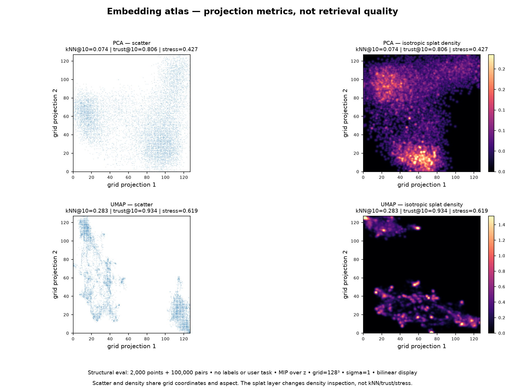

# Numeric embedding atlas — structural baseline

**Viewer recommendation:** `DEFER_USER_TASK`. This is an isotropic splat-density prototype inspired by Topo-GS, not a Topo-GS reproduction.

## Structural metrics

| Projection | kNN@10 | kNN@50 | Trust@10 | Trust@50 | Continuity@10 | Continuity@50 | Spearman | Scale-invariant stress |
|---|---:|---:|---:|---:|---:|---:|---:|---:|
| PCA | 0.0741 | 0.1897 | 0.8063 | 0.8062 | 0.8939 | 0.8662 | 0.4708 | 0.4270 |
| UMAP | 0.2834 | 0.3434 | 0.9342 | 0.8942 | 0.9314 | 0.8840 | 0.4206 | 0.6187 |

Evaluation uses 2,000 points and 100,000 non-self sampled pairs. Class separation is `not_applicable` because no labels are present; user-task accuracy was not measured.

## Reading

UMAP preserves more exact local neighbors and has higher trustworthiness than PCA in this run, but PCA retains higher distance-rank correlation and lower scale-invariant stress. This is a local-versus-global structural trade-off, not a universal projection winner or evidence of retrieval utility.

## Rendering cost and limits

- PCA fit: **0.109 s**; UMAP fit: **45.700 s**; figure render: **0.584 s**.
- Each smoothed volume: **8,388,608 bytes** at `128³`; clipped fractions: PCA **3.04%**, UMAP **3.00%**.
- PNG: **577,895 bytes**, `1800×1400`; SHA-256 `03249670068853ef2650be4a11e514f6d9ea020465c2b87ba559b9732e59bc2d`.

The splat pass shares the projection coordinates. It therefore cannot improve kNN preservation, trustworthiness, continuity or stress; only PCA-versus-UMAP differences are structural. No interactive-viewer benefit is claimed without a separate user-task study.

Protocol SHA-256: `00f339c84425bb96733ef8362a396dc242f40d0115dcb9a2064ee26f60d87667`; runner `d5edd3291afcfbfaae1c7b93231542f79a740d84411fccd69a9de0ebd8195447`; source HEAD `84583a35c32a533d434334f6d7a9b944708afa3e`.
